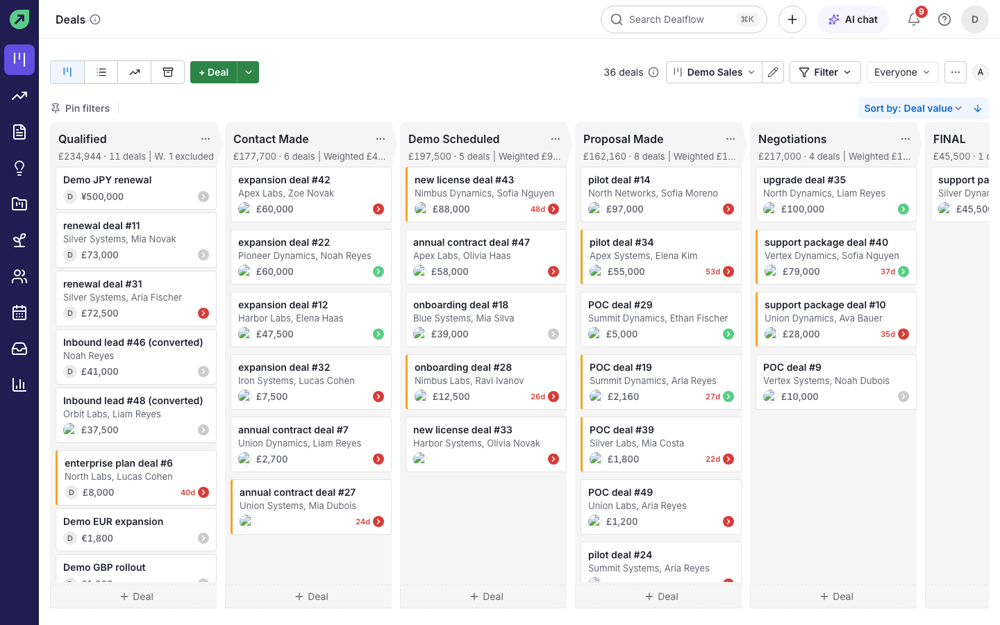

<h1 align="center">Dealflow</h1>

<p align="center">
  A self-hosted CRM for business development, built on warpdrive.<br/>
  Pipeline management, a deal workspace, contacts, two-way Gmail, and a built-in AI layer, running on your own infrastructure.
</p>

<p align="center">
  <a href="LICENSE"></a>
  
  
  
  
</p>

<p align="center">
  
</p>

Dealflow is a single-tenant, self-hosted CRM that reimplements the core business-development
workflow of Pipedrive as software you run yourself: your own box, your own Postgres and object
storage, and sign-in that does not depend on a vendor. Your customer data never leaves your
infrastructure, and there is no per-seat bill. The information architecture follows the tools BD
teams already know, the interface ships its own visual layer built on
[shadcn/ui](https://ui.shadcn.com), and Dealflow is not affiliated with or endorsed by Pipedrive.

Dealflow is built on [warpdrive](https://github.com/sneg55/warpdrive) by Nikita Sawinyh (MIT),
extended in place.

## Contents

- [Features](#features)
- [Screenshots](#screenshots)
- [Tech stack](#tech-stack)
- [Quickstart (local development)](#quickstart-local-development)
- [Self-hosting](#self-hosting)
- [AI](#ai)
- [Tests](#tests)
- [Project status](#project-status)
- [License](#license)

## Features

**Pipeline**
- Kanban board with drag-and-drop stages, multiple pipelines, and custom stages
- Per-stage weighted totals, rotting-deal indicators, and saved filters
- Board / list / archive views

**Deals**
- Deal workspace with a unified timeline: activities, notes, files, email, and full change history
- AI insights card: summary with health, risks and next steps you can add as activities, plus a 0 to 100 score
- Participants, followers, labels, lost reasons, and close dates
- Won / lost handling with a stage-progress bar

**Contacts**
- People and organizations with custom fields (JSONB)
- Organization firmographics and org-to-org relationships
- Leads inbox and CSV import with an undo step

**Email (two-way Gmail)**
- Send and receive over the Gmail API, with thread linking to deals and people
- "Write with AI" in the composer, open and click tracking, templates, signatures, merge fields, and scheduled send
- Personal inbox plus shared, deal- and contact-linked threads

**Sign-in**
- Email and password, or a single-use magic link sent by email
- Google Workspace SSO when its three environment variables are set
- Invites that email a set-password link, and a bootstrap link for the first admin

**AI**
- An assistant drawer that answers from your CRM data through the MCP tools and asks for confirmation before writing
- Deal summaries and scores, email drafts, notes to activities, and plain-English deal filters
- OpenRouter (default model `deepseek/deepseek-v4.1-flash`), with deterministic fake modes for tests

**Team and platform**
- Role-based permissions, teams, and user management
- Notifications and basic pipeline stats (funnel, deal and activity performance)
- Realtime updates across the board, inbox, notifications, and presence over WebSocket

## Screenshots

**Deal workspace:** activities, notes, files, and the full history timeline in one view.


**Inbox:** two-way Gmail with thread linking, follow-up labels, and unread state.


**Contacts:** people and organizations with custom fields.


## Tech stack

Next.js (App Router) and React with TypeScript, Drizzle ORM on Postgres, tRPC with TanStack
Query, Next server actions, shadcn/ui with Tailwind, dnd-kit for the board, Zustand for
board-local state, a self-hosted WebSocket server backed by Postgres LISTEN/NOTIFY, MinIO
(or any S3-compatible store) for files, the Gmail API via Google OAuth, OpenRouter through the
`openai` SDK for AI, and nodemailer for system mail. Package manager: pnpm.

## Quickstart (local development)

Requires Node 22 or newer, pnpm 9, and Docker.

```bash
pnpm install
pnpm env:sync          # creates .env from .env.example and fills safe local values
pnpm dev:up            # Postgres and MinIO in Docker
pnpm db:migrate:dev    # apply migrations
pnpm db:seed:demo      # demo pipeline, deals, people and email
pnpm dev
```

The app runs at `http://localhost:3000`. In development you can skip Google sign-in and use the
dev login route: `http://localhost:3000/auth/dev-login?email=demo1@example.com`.

## Self-hosting

The default Docker topology ships the app, WebSocket server, background worker, Postgres and
MinIO. There is no reverse proxy in the default stack: put your own proxy in front of the app,
the `/_ws` WebSocket route and the S3 host. See [`docs/reverse-proxy.md`](docs/reverse-proxy.md)
for the three routes, the headers that must stay on the S3 host, and a worked Caddy example in
[`docs/reverse-proxy/Caddyfile.example`](docs/reverse-proxy/Caddyfile.example). The full guide,
including Google OAuth setup and every required environment variable, is in
[`docs/deploy.md`](docs/deploy.md).

## AI

Dealflow talks to OpenRouter through the `openai` SDK. Set `OPENROUTER_API_KEY` in the server
environment and optionally `OPENROUTER_MODEL` (default `deepseek/deepseek-v4.1-flash`; the dated
snapshot `deepseek/deepseek-v4.1-flash-1017` can be pinned). With no key the AI features are
simply unavailable, and `AI_FAKE=true` gives deterministic answers for tests and demos. Every
call is logged, and admins manage the company monthly token cap and an optional per-user cap in
Settings → AI. The MCP surface is documented in [`docs/mcp-server.md`](docs/mcp-server.md).

## Email

Connect a mailbox in **Settings → Email sync** with an app password: Purelymail is a preset, and
any other IMAP/SMTP server can be entered by hand. Gmail remains available when Google is
configured. Inbound mail syncs into threads, the inbox and record timelines; replies thread with
`In-Reply-To` and `References`, and a copy of every sent message is APPENDed to the mailbox's Sent
folder. `pnpm mail:live-check` proves the real transports against the Purelymail test mailbox.
Details, limits and the fake transport used by tests are in
[`docs/dealflow/MAIL.md`](docs/dealflow/MAIL.md).

## Products, currencies and forecast

The product catalog and deal line items live under Settings > Products and the deal page's
Products section. A deal has a currency and an optional probability override, stages carry their
own probability, and rates are manual under Settings > Currencies. The board and deals list show
totals converted to the base currency (deals without a rate are counted as excluded), the board
also shows the weighted total, and `/forecast` groups open deals by expected close month (drag a
card to re-date it). Money math uses integer minor units, never floats. See
[docs/dealflow/SALES.md](docs/dealflow/SALES.md).

## Quotes and invoices

Deals with product lines can produce a quote or an invoice that snapshots the lines at
creation. Documents are numbered on issue, sent through your own mailbox with a public
link, accepted or declined by the customer on `/d/{publicId}`, and paid through
hand-recorded payments; a daily job marks unpaid invoices overdue. Templates, numbering,
company details and payment instructions live in Settings > Documents. See
[docs/dealflow/DOCUMENTS.md](docs/dealflow/DOCUMENTS.md) for the model, status rules and
the printing path.

## Tests

```bash
pnpm test:unit          # fast unit tests, no containers
pnpm test:integration   # disposable Postgres via Testcontainers
pnpm e2e                # Playwright against a production build on port 3210
```

Integration tests run against a real Postgres (never a mock) so migrations and queries are
exercised as they run in production.

## Project status

Dealflow is used in production for a single team's BD workflow and is actively developed. The
features listed above are built and working. Products, projects, invoicing, forecasting and
multi-currency are deliberately out of scope; the focus is depth and polish on the core
pipeline, deal, contact and email surfaces.

## License

MIT. See [`LICENSE`](LICENSE). Dealflow builds on warpdrive, copyright Nikita Sawinyh, also MIT.

## Automations and webhooks

Automations run actions when domain events happen: create an activity, update a deal, send a saved
email template, notify a user, or run an AI summary, score or draft. Admins create them under
Settings > Automations from scratch, from six built-in templates, or by describing one in a sentence
(the AI draft opens for review, disabled).

Webhooks deliver the same events as signed JSON POSTs. Each delivery is retried with backoff,
address-checked inside the DNS lookup, and auto-disabled after ten consecutive failures; the delivery
log keeps the last 100 attempts per subscription with redeliver and test send. See
`docs/dealflow/AUTOMATIONS.md` and `docs/dealflow/WEBHOOKS.md`.

## Forms and booking pages

Public forms live at `/f/{publicId}` and can be embedded on any site. A submission finds or creates
the person and organization, creates a lead or a deal through the same services a signed-in user
uses, writes the message as a note, notifies the form owner and emits `form.submitted`. A honeypot,
a signed start token, a two-second minimum fill time and a rate limit hold spam off; the form works
without JavaScript.

Booking pages live at `/book/{publicId}`. Free slots come from the host's weekly availability, the
minimum notice, the days-ahead window, buffers and the host's existing timed activities, shown in the
visitor's own time zone. A booking re-checks the slot under a per-host lock, creates the activity,
notifies the host and emails the visitor a cancel link. See `docs/dealflow/FORMS.md` and
`docs/dealflow/SCHEDULING.md`.
