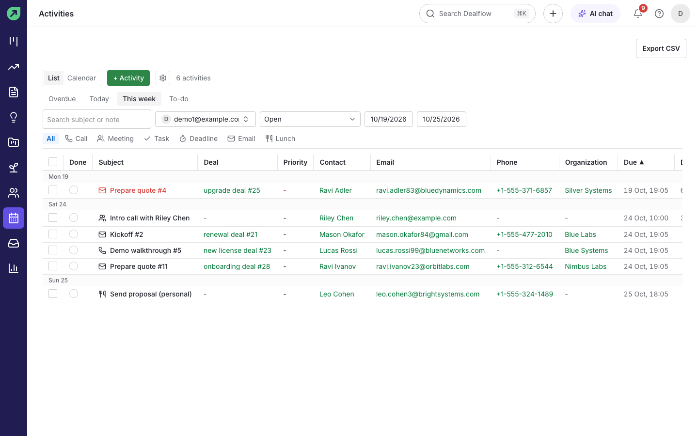
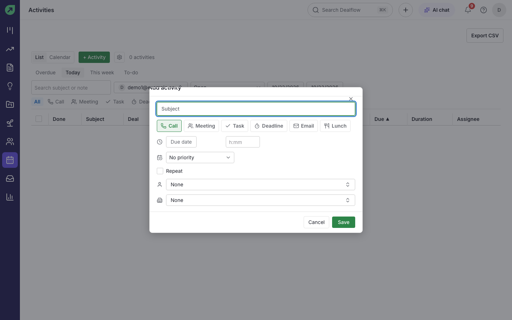
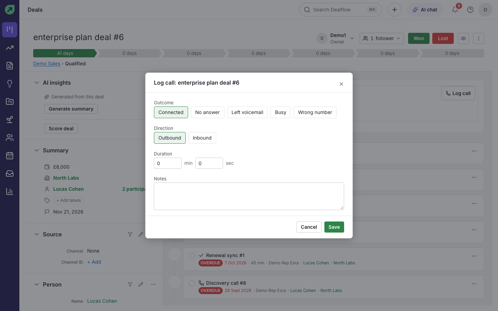
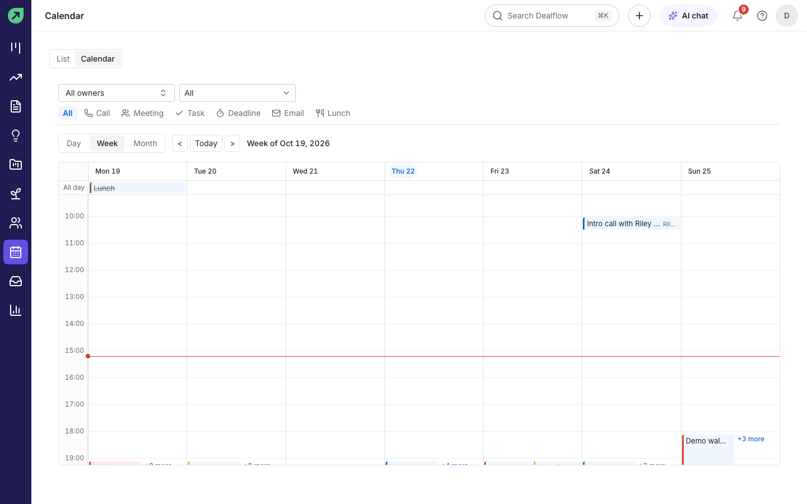

# Activities and calendar

**Activities** are the calls, meetings, tasks, deadlines, emails and lunches that move deals forward. Every activity has a subject, a type and a due date, and can be linked to a deal, person or organization.

## How to see what you need to do

1. Select **Activities** in the left rail.
2. Choose **Overdue**, **Today**, **This week** or **To-do** at the top.
3. Narrow the list by owner, status (Open or Done), dates, or type (**Call**, **Meeting**, **Task**, **Deadline**, **Email**, **Lunch**).

**Tips:**

- Tick the box at the start of a row to mark the activity done.
- Select **Export CSV** to download the list.

## How to schedule an activity

1. Select **+ Activity** (or press `n` then `a`, or choose **Activity** from Quick add).
2. Type a **Subject** and pick the type: Call, Meeting, Task, Deadline, Email or Lunch.
3. Set the due date and time, and the priority if you use one.
4. Link it to a deal, person or organization.
5. Select **Save**.

**Result:** the activity appears in your list, on the calendar, and on the linked records. If it is linked to a deal, the deal's next-activity dot turns green.

**Tip:** on a deal, the **Activity** tab under the deal header does the same thing with the deal already linked.

## How to make an activity repeat

1. In the activity form, tick **Repeat this activity**.
2. Choose how often, and for weekly repeats tick the days (for example **Mon** and **Thu**).
3. Select **Save**.

**Result:** Dealflow creates the next occurrence each time you complete the current one, so your list only ever shows the next one.

## How to log a call

1. Open the deal, person or organization, and select **Log call** (or press `n` then `c`, or use **Log call** in the command palette).
2. Choose the **Outcome**: **Connected**, **No answer**, **Left voicemail**, **Busy** or **Wrong number**.
3. Choose the **Direction** (**Outbound** or **Inbound**), and enter the **Duration** and any **Notes**.
4. Select **Save**.

**Result:** a completed call activity is added to the record's history with its outcome, so you can filter calls by outcome later.

## How to use the calendar

1. In **Activities**, select **Calendar**.
2. Choose **Day**, **Week** or **Month**, and move between periods with **<**, **Today** and **>**.
3. Filter by owner and type at the top.
4. Select an empty slot to add an activity at that time, or select an activity to open it.

**Tip:** the red line marks the current time.
