# Admin

This section is for admins: the people who set Dealflow up for the company. Most of these pages are under **Settings** (open the **Account menu** and choose **Settings**). The settings menu has two parts: **My account** (your own preferences, which every user has) and **Company overview** (company-wide settings, shown only to users with the right permissions). The menu stays in place while the page beside it scrolls.

## How to invite a user

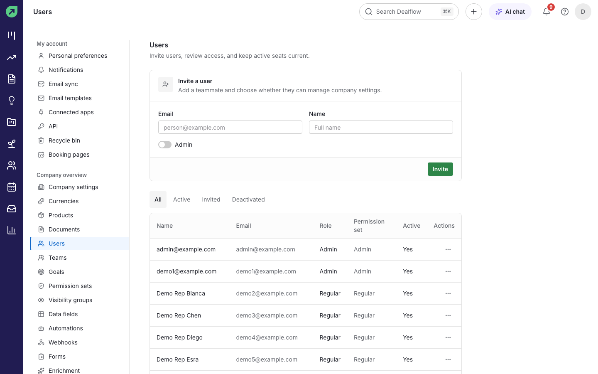

1. Go to **Settings › Users**.
2. Under **Invite a user**, type their **Email** and **Name**. Turn on **Admin** only if they should manage company settings.
3. Select **Invite**.

**Result:** they receive an invite email with a link to set their password, and appear under **Invited** until they accept.

**Tips:**

- Use the row's menu in the list to change a user's permission set or to deactivate them. A deactivated user cannot sign in, but their records stay.
- The filters above the list show **All**, **Active**, **Invited** or **Deactivated** users.

## How to control what people can do

**Permission sets** decide what users can do. Dealflow comes with **Regular** (create deals, contacts and activities, and edit their own) and **Admin** (everything).

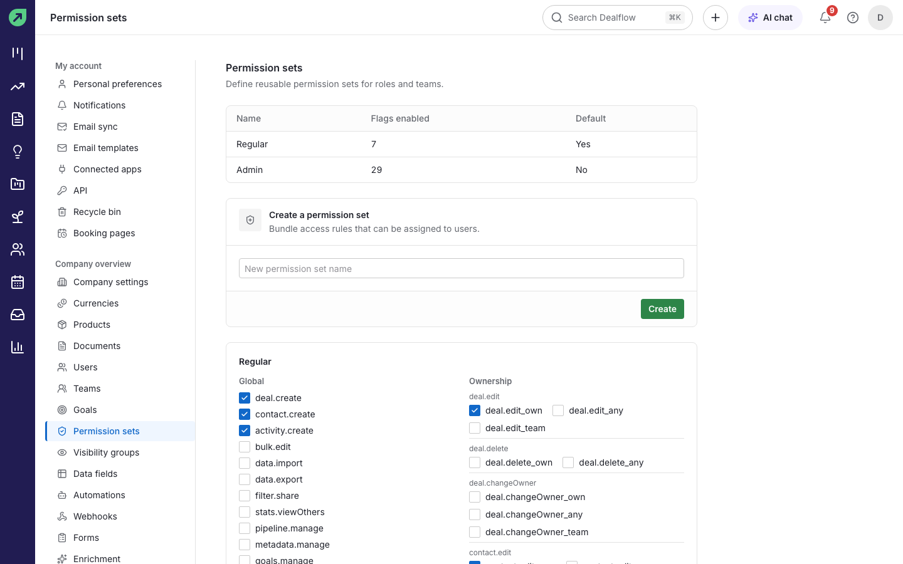

1. Go to **Settings › Permission sets**.
2. To make a new set, type a name under **Create a permission set** and select **Create**.
3. Tick the permissions the set should have. Examples: `data.import`, `data.export`, `bulk.edit`, `pipeline.manage`, `products.manage`, `documents.manage`, `automations.manage`, `forms.manage`, `goals.manage`, and whether users can edit their own records, their team's, or anyone's.
4. Assign the set to users in **Settings › Users**.

## How to control what people can see

**Visibility groups** decide which records a group of users can see.

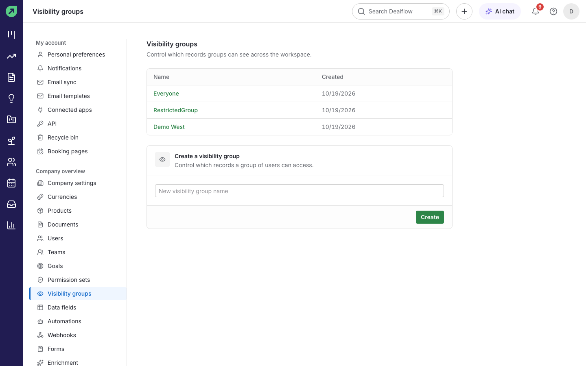

1. Go to **Settings › Visibility groups**.
2. Type a name under **Create a visibility group** and select **Create**.
3. Open the group to add members and choose what they can see.

## How to organise users into teams

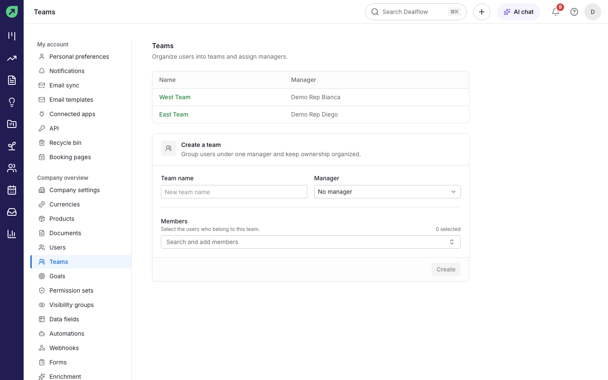

1. Go to **Settings › Teams**.
2. Under **Create a team**, enter the **Team name**, choose a **Manager**, and add **Members**.
3. Select **Create**.

**Result:** teams can be used for goals, reports and filters.

## How to set company-wide options

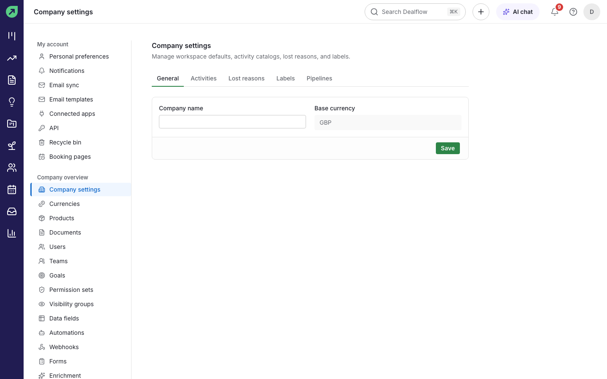

1. Go to **Settings › Company settings**.
2. On **General**, set the **Company name** and the **Base currency** every total is converted into.
3. Use the tabs to manage **Activities** (activity types), **Lost reasons**, **Labels** and **Pipelines**.

## How to set exchange rates

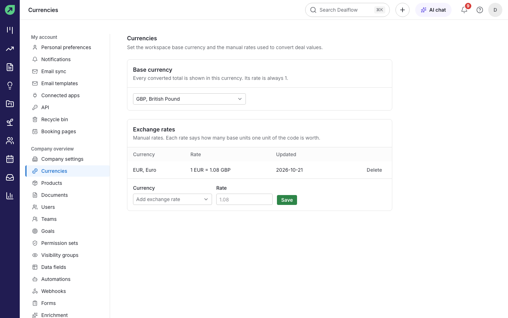

1. Go to **Settings › Currencies**.
2. Under **Exchange rates**, choose a **Currency**, enter the **Rate** (how many units of your base currency one unit is worth, for example 1 EUR = 1.08 GBP) and select **Save**.

**Tip:** rates are not updated automatically. Review them when they move.

## How to add custom fields

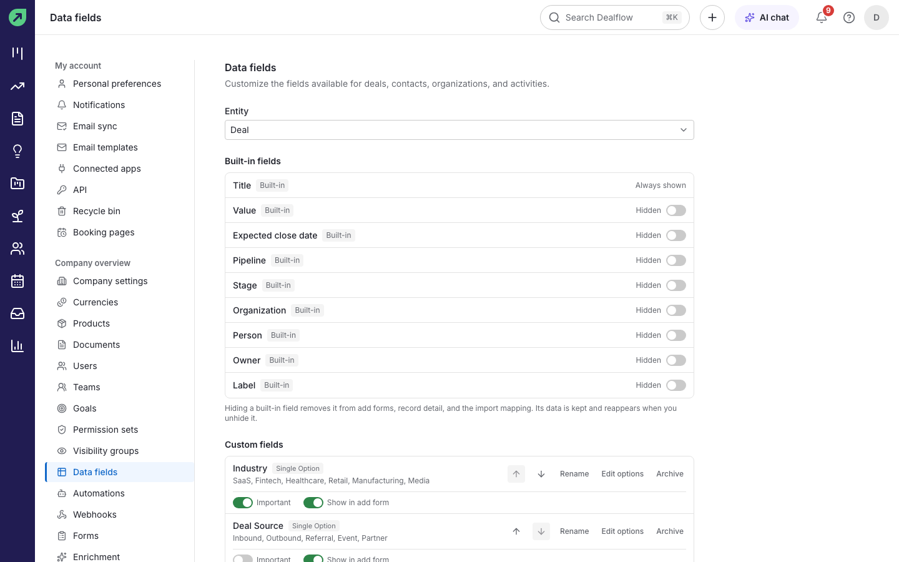

1. Go to **Settings › Data fields** and choose the **Entity**: deals, people, organizations or activities.
2. Under **Custom fields**, add a field and choose its type (for example a single option list such as Industry).
3. Choose whether it is **Important**, shown in add forms, or required.
4. To hide a built-in field you do not use, turn it off under **Built-in fields**.

## How to automate routine work

You need permission to manage automations. Automations run as the user who created them.

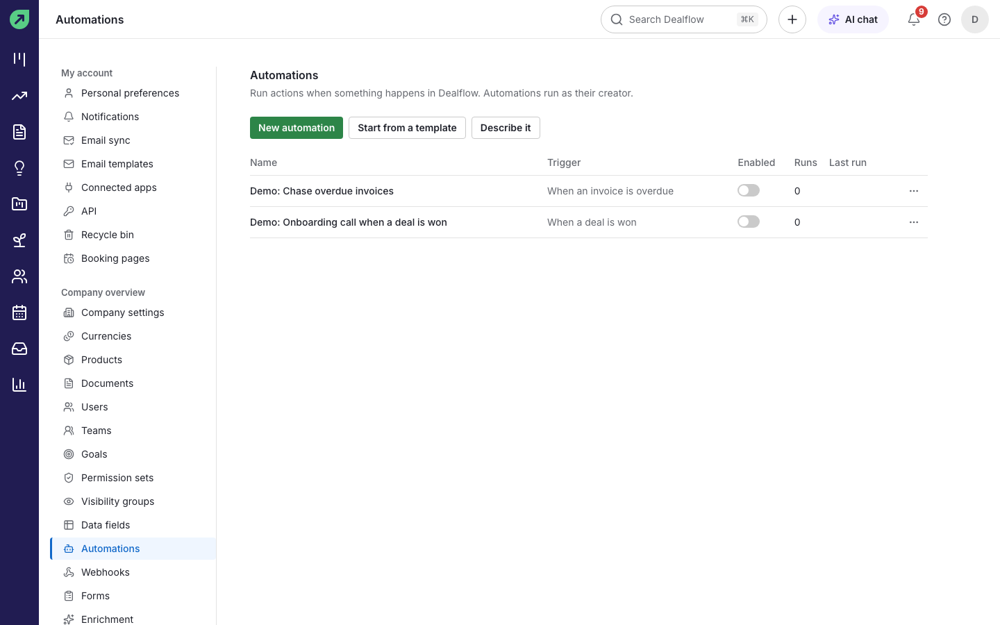

1. Go to **Settings › Automations**.
2. Select **New automation**, **Start from a template**, or **Describe it** to type what you want in a sentence and select **Draft it**.
3. Set **When** (the trigger, for example "a deal is won"), **Only if** (optional conditions) and **Then** (up to 10 actions in order).
4. Turn on **Enabled** and save.

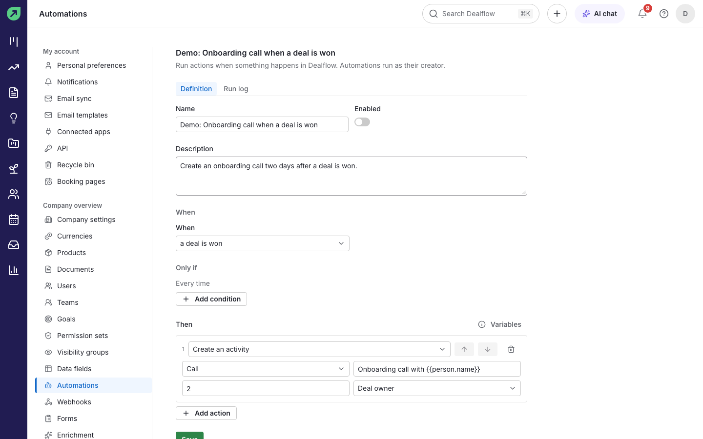

**Actions available:** update the deal, create an activity, add a note, notify a user, send a saved email template, and the AI steps: summarise the deal, score the deal and draft an email. Text fields can use variables such as `{{deal.title}}` and `{{person.first_name}}`.

**Tips:**

- The **Run log** tab shows every run and why any run failed or was skipped.
- Dealflow stops automations from triggering each other in an endless loop.

## How to send events to another system (webhooks)

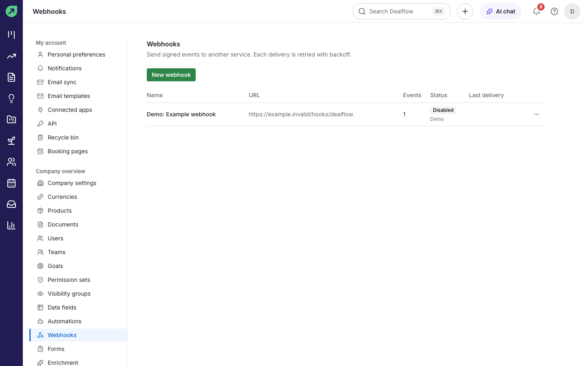

1. Go to **Settings › Webhooks** and select **New webhook**.
2. Enter a **Name** and the **URL** to send to, and tick the **Events** you want (for example `deal.won`, `person.created`, `invoice.paid`, `form.submitted`).
3. Select **Create**.

**Result:** each event is sent as a signed request to that URL. Failed deliveries are retried several times over a few hours. After ten deliveries in a row fail, the webhook is disabled and you are told. Use the webhook's **Delivery log** to see what was sent.

## How to give another tool API access

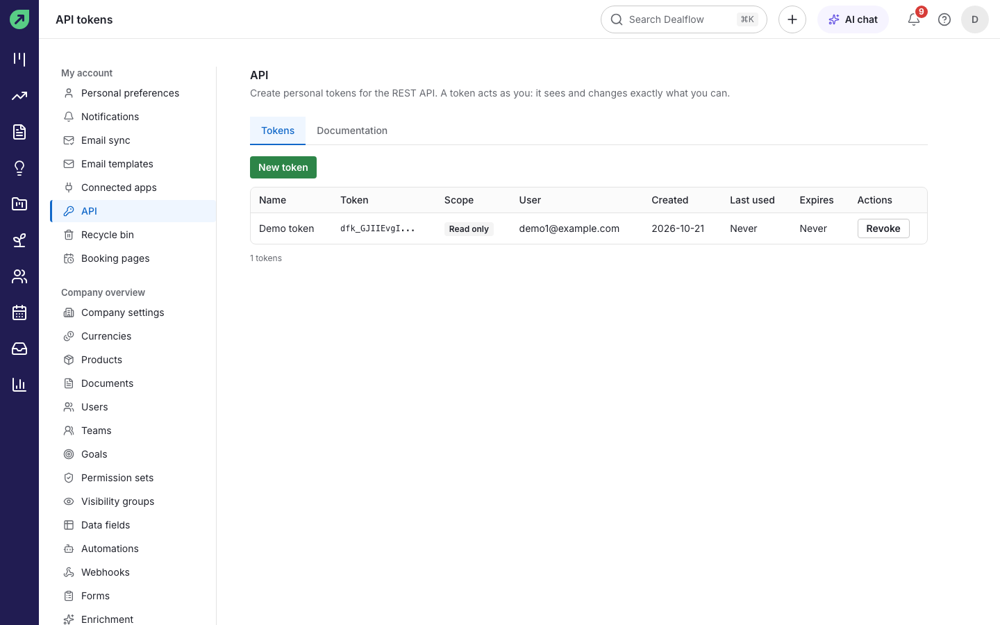

1. Go to **Settings › API** (each user can do this for themselves).
2. Enter a **Name**, choose the **Scope** (read only, or **Read and write**) and select **Create token**.
3. Copy the token now. It is shown once.

**Result:** the token works with the Dealflow REST API and sees exactly what you can see. The **Documentation** tab describes every endpoint. **Revoke** a token to stop it working.

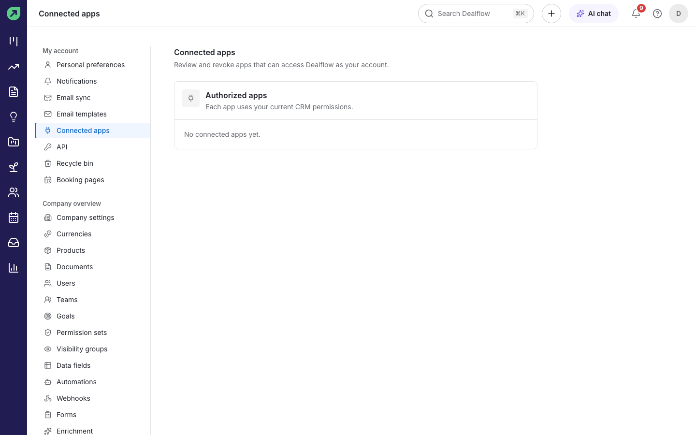

**Connected apps:** AI tools that connect to Dealflow (through its MCP server) appear in **Settings › Connected apps**, where you can revoke them.

## How to manage AI

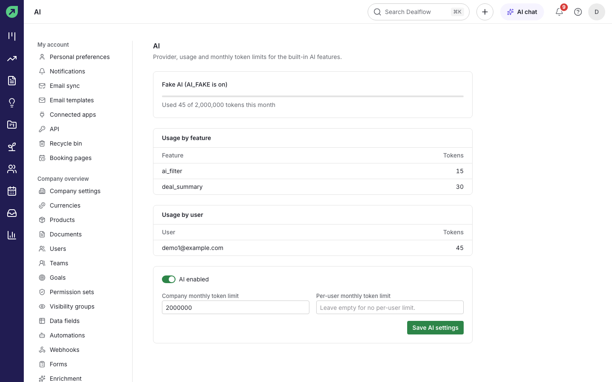

1. Go to **Settings › AI**.
2. See which AI provider and model are in use, and how many tokens have been used this month, by feature and by user.
3. Turn AI on or off for the company, and set the **Company monthly token limit** and an optional **Per-user monthly token limit**.
4. Select **Save AI settings**.

**Result:** when a limit is reached, AI features stop until the next month and users see a message saying so.

## How to restore something deleted

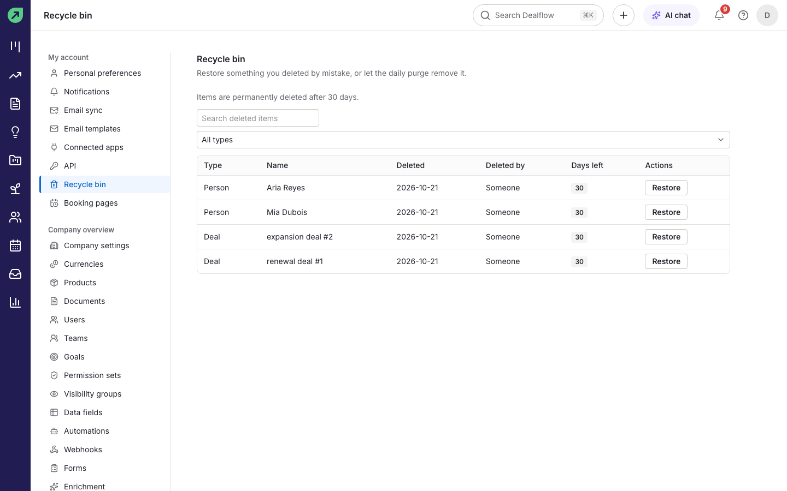

1. Go to **Settings › Recycle bin**.
2. Find the item (filter by type or search) and select **Restore**.

**Result:** the record is back where it was. Items are permanently deleted after 30 days; **Days left** shows how long each one has.

## How to review security changes

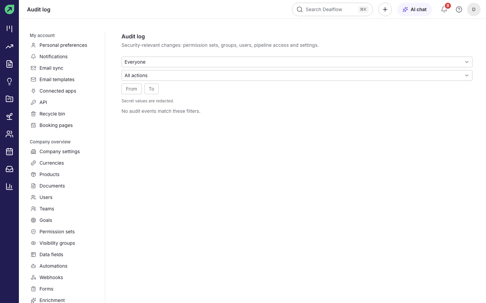

Go to **Settings › Audit log** to see who changed permission sets, groups, users, pipeline access and settings, and when. Filter by person, action and date. Secret values are never shown.

## How to check backups

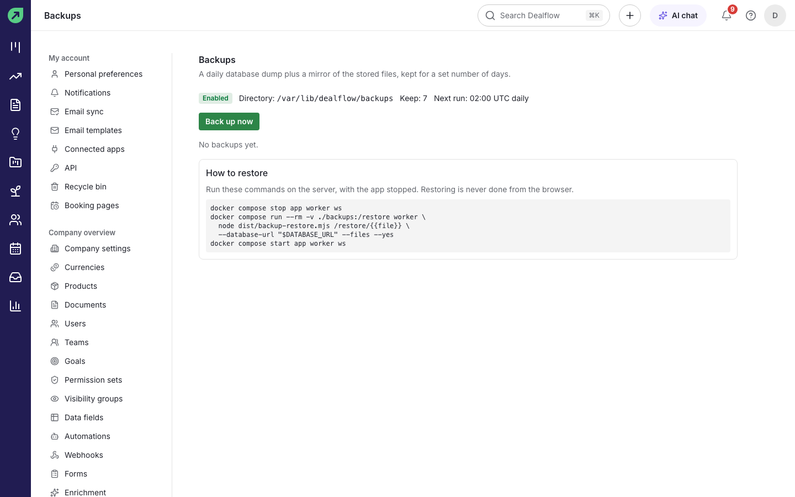

1. Go to **Settings › Backups**.
2. Check the status, the folder, how many days are kept and the next run time (daily at 02:00 UTC by default).
3. Select **Back up now** for an extra backup, for example before a big import.

**Restoring** is done on the server, never from the browser. The page lists the exact commands; see also [Self-hosting](self-hosting.md#backups-and-restore).

## Other settings

- **Import data:** see [Contacts and organizations](contacts-and-organizations.md#how-to-import-contacts-from-a-csv-file).
- **Products** and **Documents:** see [Quotes and invoices](quotes-and-invoices.md).
- **Forms** and **Booking pages:** see [Forms and booking pages](forms-and-booking.md).
- **Goals:** see [Stats and reporting](stats-and-reporting.md#how-to-set-a-goal).
- **Enrichment (optional):** connect Apollo, RocketReach or GetProspect with your own API key in **Settings › Enrichment** to let users fill in missing contact details. Each provider stays off until you add its key.
