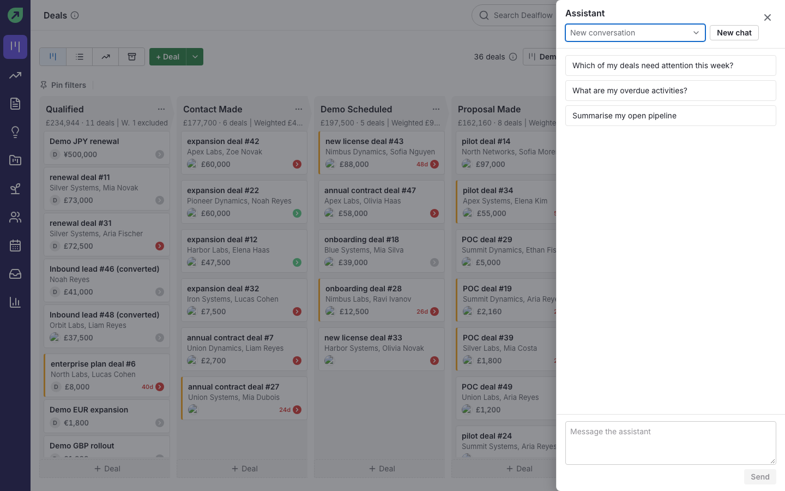
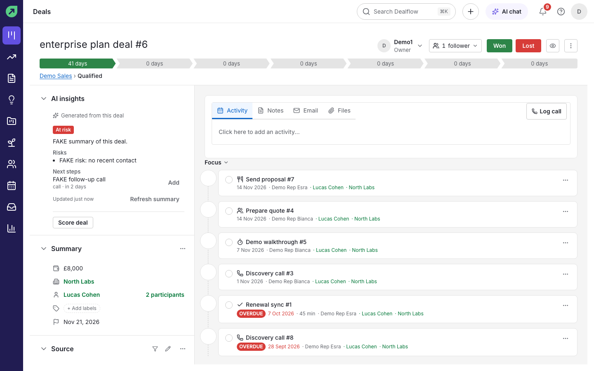
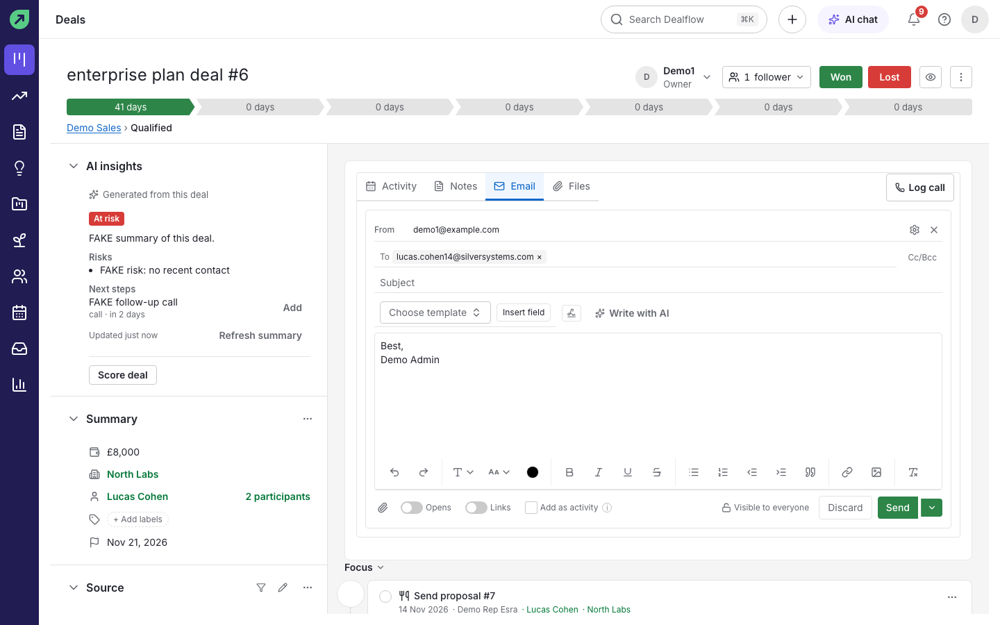
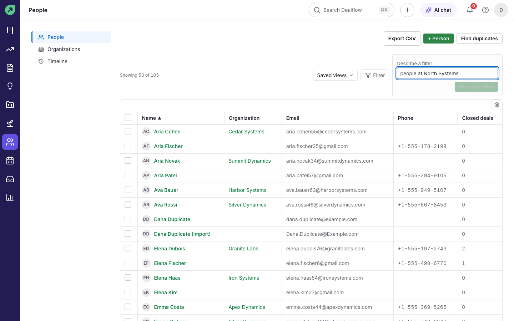

# AI features

Dealflow has AI built in. It can summarise a deal, score how likely it is to close, draft emails, turn meeting notes into activities, build filters from plain English, explain reports and answer questions in a chat. An admin can turn AI off or set monthly limits (see [Admin](admin.md#how-to-manage-ai)).

**Good to know:**

- The AI sees only the records you can see.
- It never changes anything without asking you first.
- Everything it suggests is a draft: check it before you rely on it.

## How to ask the assistant

1. Select **AI chat** in the top bar.
2. Pick a suggested question (for example "Which of my deals need attention this week?") or type your own in **Message the assistant**.
3. Select **Send**.

**Result:** the assistant answers using your Dealflow data. If it wants to make a change, such as adding a note or an activity, it shows the change with **Confirm** and **Reject** buttons and does nothing until you confirm.

**Tips:**

- **New chat** starts a fresh conversation. Earlier conversations are kept in the list at the top.
- Press `Escape` to close the panel.

## How to summarise a deal

1. Open the deal.
2. In **AI insights**, select **Generate summary**.

**Result:** a short summary of the deal, its **Risks** and suggested **Next steps** appear. Select **Add** next to a next step to turn it into an activity. **Refresh summary** updates it after the deal changes.

## How to score a deal

1. Open the deal.
2. In **AI insights**, select **Score deal**.

**Result:** a score badge appears on the deal showing how likely it is to close.

**Tip:** to score many deals at once, switch the board to **List view**, tick the deals and select **Score with AI**. You get a notification when scoring finishes.

## How to draft an email with AI

1. Start a new email from a deal, contact or the inbox.
2. Select **Write with AI** and, in **What should the email say?**, describe it, for example "Thank them for the call and send the pricing we discussed".
3. Select **Draft**.

**Result:** the subject and body are filled in. Edit them as you like, then send, or select **Discard** to throw the draft away.

## How to turn notes into activities

1. On a deal, add a note (for example "Call went well, send pricing Friday") and save it.
2. Open the note's **More actions** menu and choose **Turn into activities**.
3. In **Suggested activities**, check or change each suggestion and select **Create selected**.

**Result:** the activities are created and linked to the deal.

## How to build a filter in plain English

1. In **Leads**, **People** or **Organizations**, type what you want in **Describe a filter**, for example "people at North Systems". On the pipeline, select **Filter** then **Create new filter** to find the same box.
2. Select **Generate filter**.

**Result:** Dealflow turns your sentence into filter conditions and applies them. Open **Filter** to see or adjust the conditions it chose.

## How to get a report explained

1. Open a report in **Insights**.
2. Select **Explain**.

**Result:** a short written explanation of what the chart shows, such as trends and the biggest contributors.

## How to automate with AI

Admins can describe an automation in a sentence and let Dealflow draft it, and automations can include AI steps. See [Admin](admin.md#how-to-automate-routine-work).
