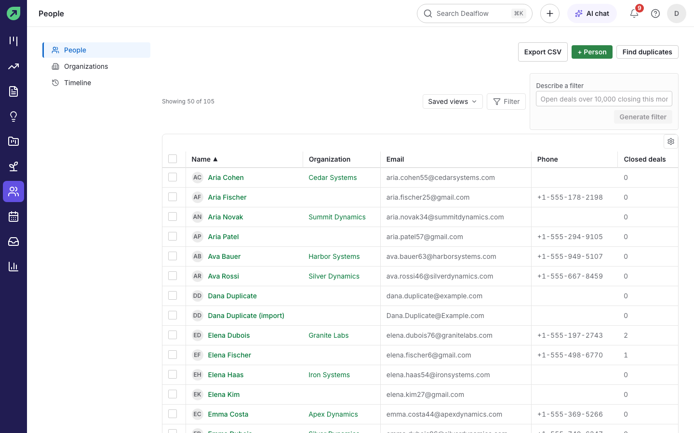
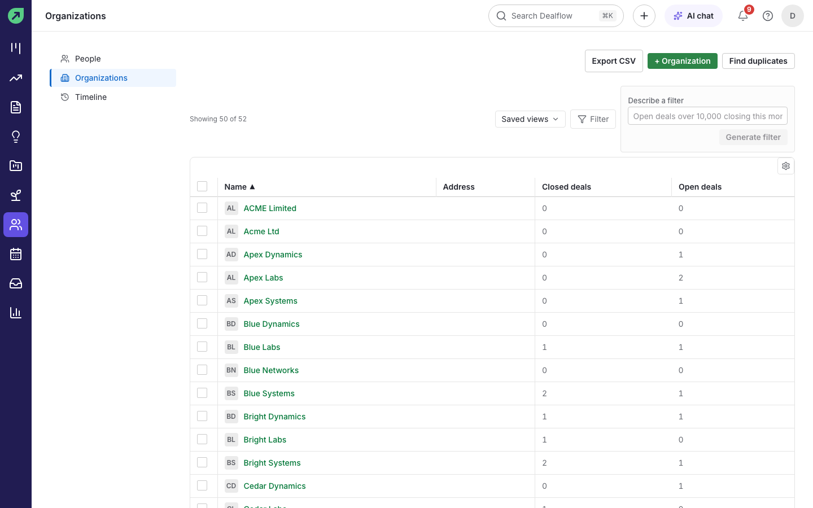
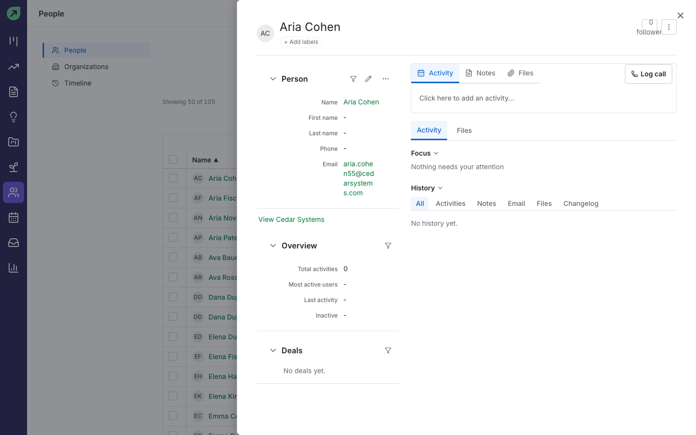
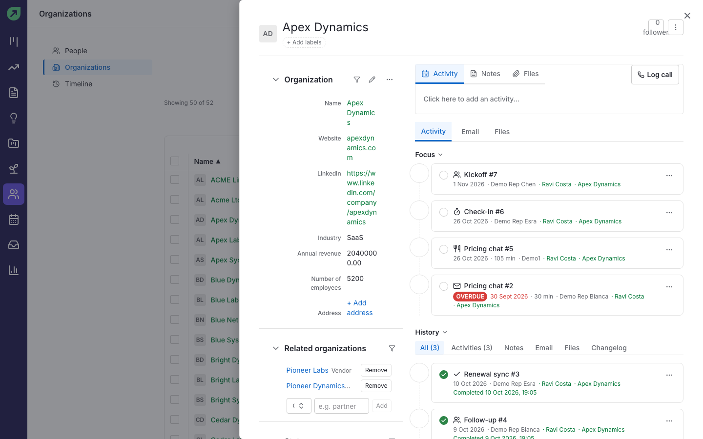
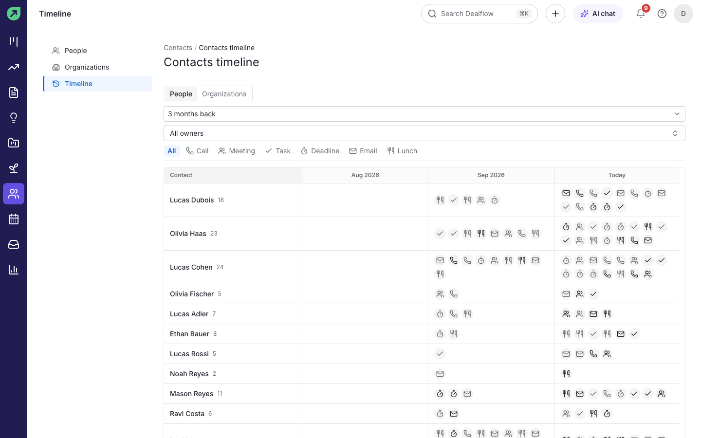
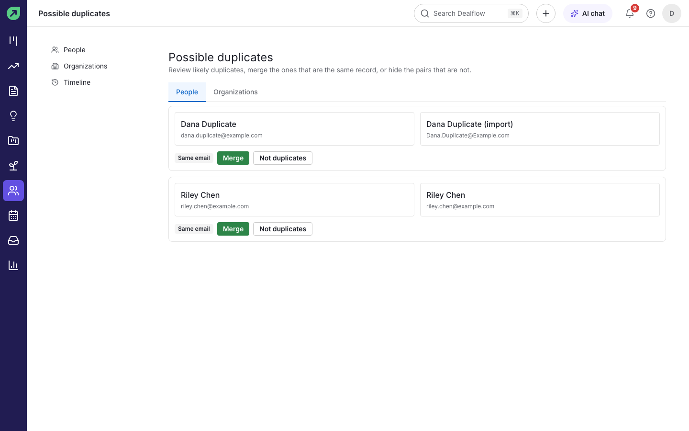
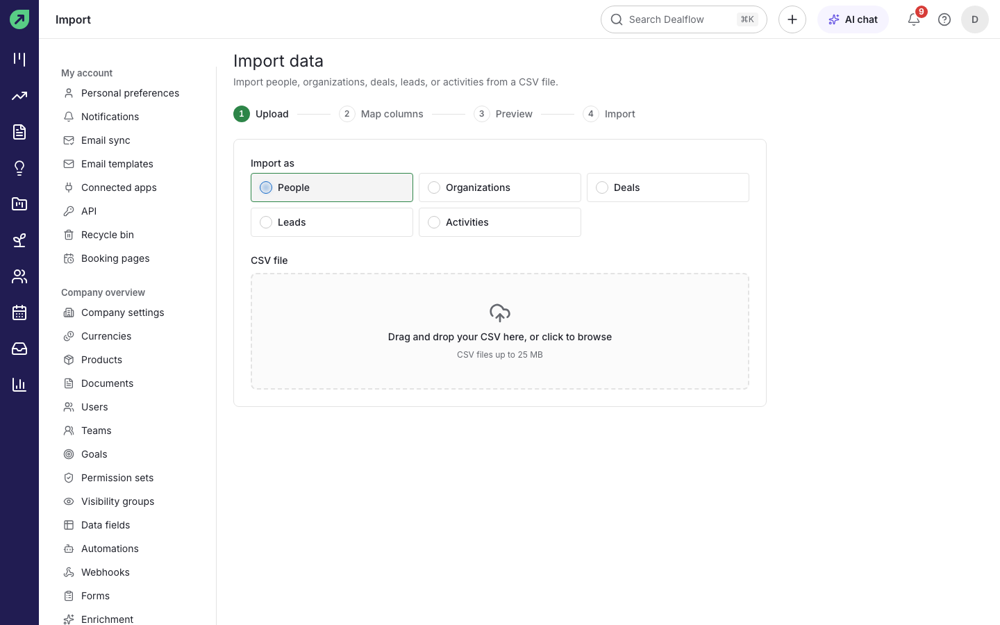

# Contacts and organizations

**People** are the individuals you deal with. **Organizations** are the companies they work for. Both live under **Contacts** in the left rail.

## How to find a person or organization

1. Select **Contacts** in the left rail. **People** opens first; select **Organizations** for companies.
2. Type in the search box, use **Saved views** or **Filter**, or describe what you want in **Describe a filter** (see [AI features](ai-features.md)).
3. Select a name to open the record.

## How to add a person or organization

1. Select **+ Person** or **+ Organization** (or press `n` then `p` or `n` then `o`).
2. Fill in the name and any details you have, such as email, phone and organization.
3. Save.

**Result:** the record opens and is ready for activities, notes and email.

## What a person or organization shows

- **Details** on the left: name, phone, email, labels, followers and company-specific fields. Select a value to edit it in place.
- **Overview:** total activities, the most active users, the last activity and how long the contact has been inactive.
- **Deals** linked to the contact.
- **Activity**, **Notes**, **Files** and **Log call** on the right, with the full **History** below.

Organizations also list **Related organizations** (for example a parent company) and the people who work there.

## How to see recent contact across all your contacts

1. In **Contacts**, select **Timeline**.
2. Choose **People** or **Organizations**, how far back to look, the owner and the activity types.

**Result:** one row per contact, with an icon for each activity in each week, so you can spot contacts nobody has spoken to lately.

## How to merge duplicates

You need permission to merge contacts.

1. In **People** or **Organizations**, select **Find duplicates**.
2. Review each pair. The reason they match (for example **Same email**) is shown underneath.
3. Select **Merge** to open the merge dialog with both records selected, choose which values to keep, and confirm. Or select **Not duplicates** to hide the pair for good.

**Result:** the two records become one.

**Tip:** people match on the same email, the same phone number or the same name at the same organization. Organizations match on name (ignoring suffixes such as Ltd) or website domain.

## How to edit many contacts at once

1. In the people or organizations list, tick the boxes next to the records.
2. Use the bulk actions that appear to change a field for all of them.

You need the bulk-edit permission for this.

## How to import contacts from a CSV file

You need permission to import data.

1. Go to **Settings › Import data** and select **New import**.
2. Choose what you are importing: **People**, **Organizations**, **Deals**, **Leads** or **Activities**.
3. Drag your CSV file onto the page or select it.
4. **Map columns**: match each column in your file to a Dealflow field.
5. **Preview** the result and then **Import**.

**Result:** the records are created, and the import appears in the **Import data** list.

**Tip:** if an import goes wrong, select **Undo** next to it in the **Import data** list. Dealflow removes the records that import created.

## How to export contacts

In the people or organizations list, select **Export CSV**. The file contains the records your current filter shows. You need the export permission.

## How to fill in missing details automatically (optional)

If your admin has connected an enrichment provider (Apollo, RocketReach or GetProspect) in **Settings › Enrichment**, a **Fill the gaps** action can complete a person or organization from that provider. This is off unless your admin sets it up, and turning it on sends the record's name, email or domain to that provider.
