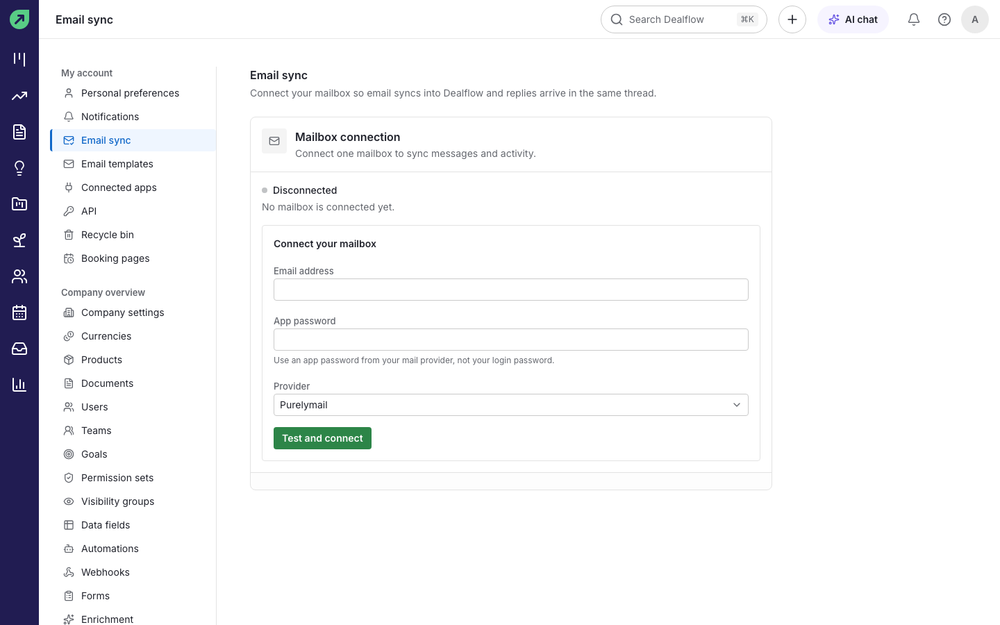
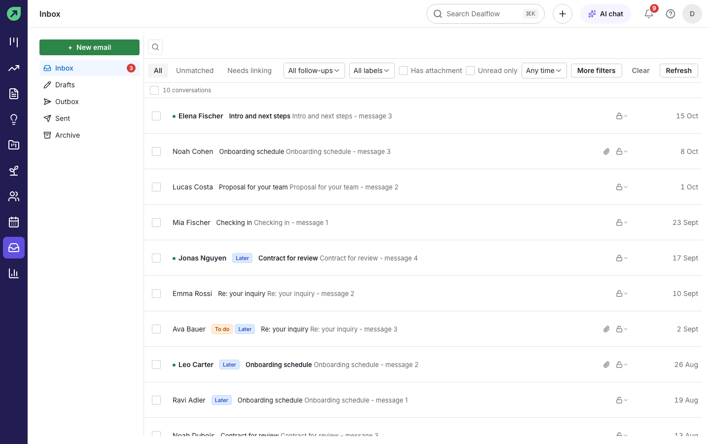
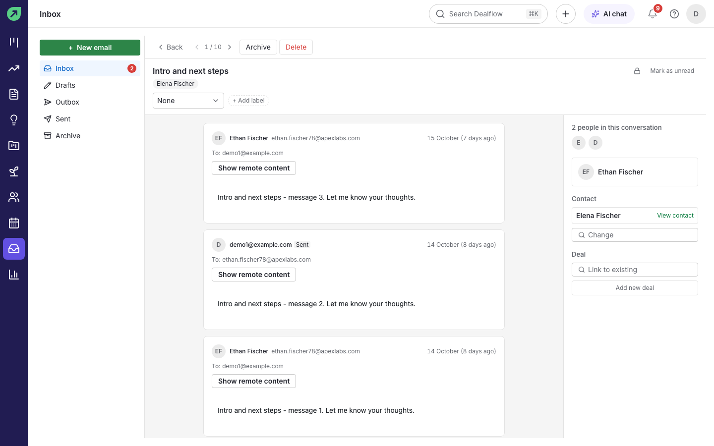
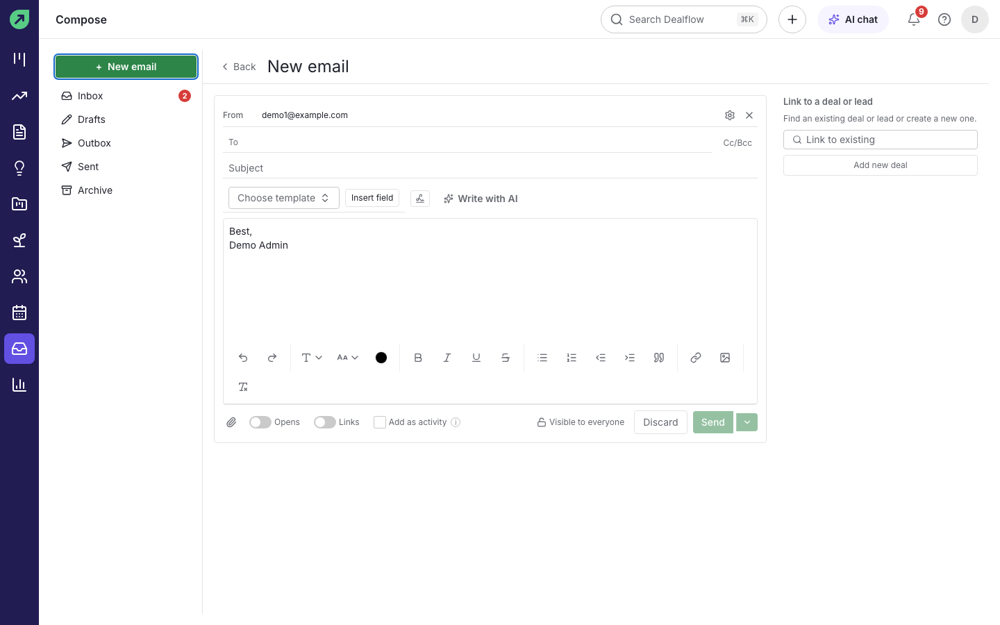
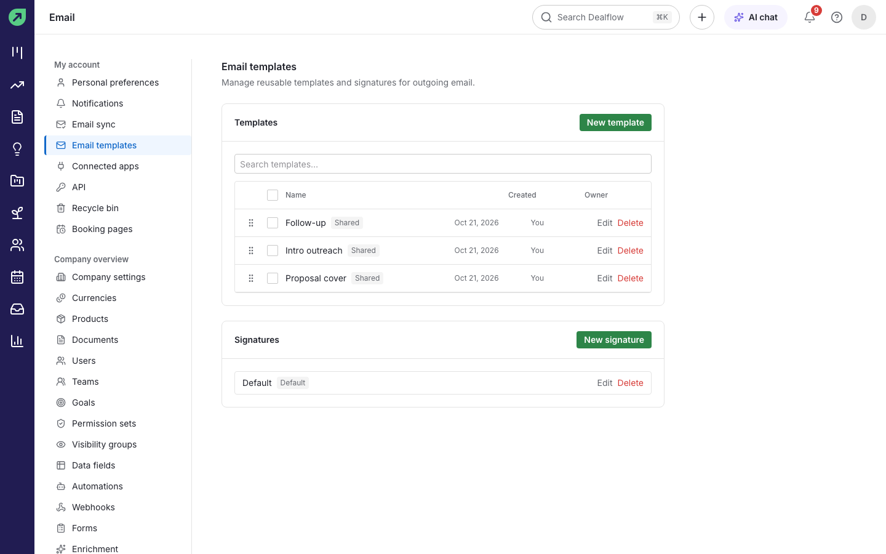

# Email

Dealflow connects to your own mailbox over IMAP and SMTP, so email you send and receive appears in Dealflow, threaded and linked to the right deals and contacts. Replies from Dealflow go out through your normal mail server and land in your Sent folder.

## How to connect your mailbox

You need an **app password** from your mail provider. This is a separate password made for one app, not the password you use to sign in to your mail. Your provider's help pages explain how to create one.

1. Go to **Settings › Email sync**.
2. Type your **Email address** and the **App password**.
3. Choose your **Provider**: **Purelymail**, or **Other IMAP/SMTP server** and enter the server details your provider gives you.
4. Select **Test and connect**.

**Result:** the status changes to **Connected** and Dealflow starts syncing your recent mail. Older mail is fetched in the background.

**Tips:**

- If the test fails, check the address and app password first. Most failures are a mistyped app password.
- To stop syncing, select **Disconnect** on the same page.

## How to read your email

1. Select **Inbox** in the left rail.
2. Use the folders on the left: **Inbox**, **Drafts**, **Outbox** (scheduled email), **Sent** and **Archive**.
3. Narrow the list with **All**, **Unmatched** (email not yet linked to a contact), **Needs linking**, follow-up status, labels, **Has attachment**, **Unread only** and the date range.
4. Select a conversation to open it.

**Result:** the conversation opens with every message in order. The right-hand panel shows the people in the conversation and the contact and deal it is linked to.

**Tips:**

- Images from outside senders are hidden until you select **Show remote content**.
- **Archive**, **Delete** and **Mark as unread** are at the top of the conversation.

## How to link an email to a deal or contact

1. Open the conversation.
2. In the right-hand panel, under **Deal**, select **Link to existing** and choose the deal, or select **Add new deal**.
3. Under **Contact**, use **Change** to pick a different person if needed.

**Result:** the email shows in the deal's and contact's history under **Email**.

## How to reply

1. Open the conversation and select **Reply**.
2. Write your reply and select **Send**.

**Result:** the reply is sent from your mailbox and added to the same conversation.

## How to write a new email

1. Select **+ New email** in the inbox (or **Email** in Quick add, or the **Email** tab on a deal or contact).
2. Fill in **To** and the **Subject**. Use **Cc/Bcc** if you need them.
3. Write your message. You can:
   - pick a saved template with **Choose template**,
   - add a merge field such as the person's name with **Insert field**,
   - ask the AI to write it with **Write with AI** (see [AI features](ai-features.md)),
   - attach files with the paperclip.
4. Select **Send**, or use the arrow next to it and choose **Send later** to schedule it.

**Result:** the email is sent (or waits in **Outbox** until its time), and appears in **Sent**.

**Tips:**

- **Link to a deal or lead** on the right keeps the email with the right record.
- **Visible to everyone** controls whether teammates can read the conversation. Turn it off for private email.

## How to see whether your email was opened

1. Before sending, leave the **Opens** and **Links** switches at the bottom of the email on.
2. Send the email.

**Result:** when the recipient opens the email or selects a link in it, Dealflow records it and can notify you ("Your email was opened").

**Tip:** opens are counted only when the recipient's mail app loads images, so "not opened" does not always mean "not read".

## How to set a follow-up reminder on a conversation

Open the conversation and use the follow-up control under the subject to mark it (for example **To do** or **Later**). Use the follow-up filter in the inbox to see everything you still need to chase.

## How to manage templates and signatures

1. Go to **Settings › Email templates**.
2. Select **New template**, give it a name, subject and body, and choose whether to share it with the team.
3. Under **Signatures**, select **New signature** to add the sign-off used at the bottom of your emails.

**Result:** shared templates appear in everyone's **Choose template** list.
