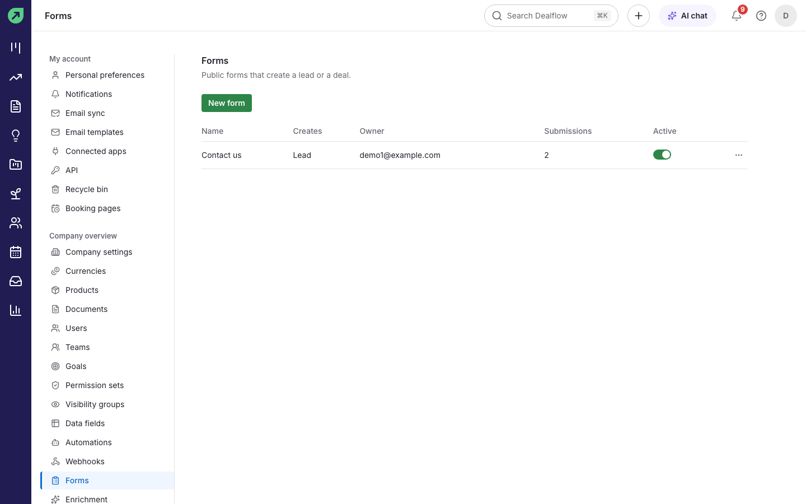
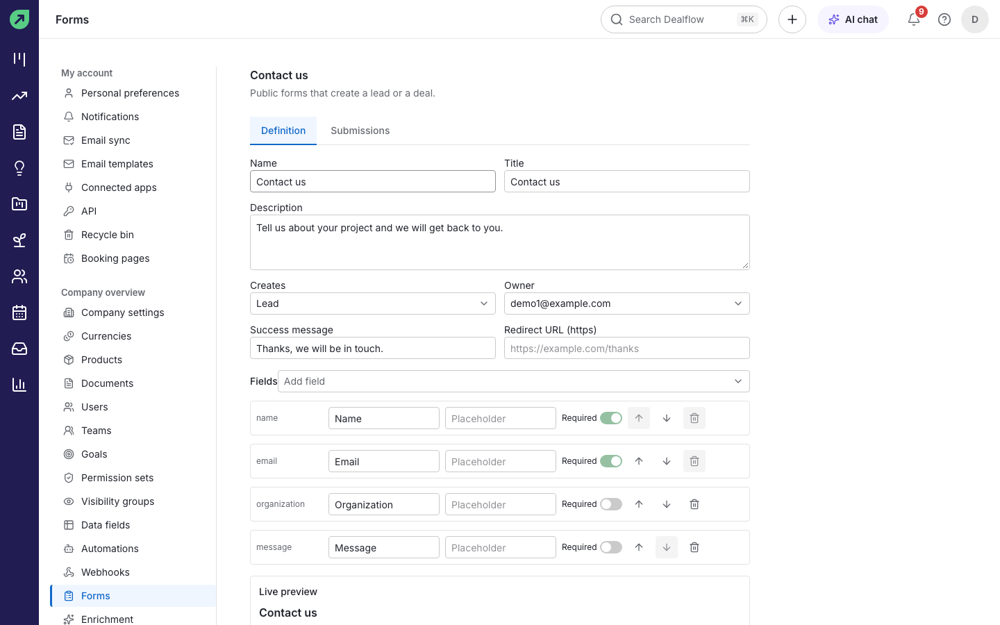
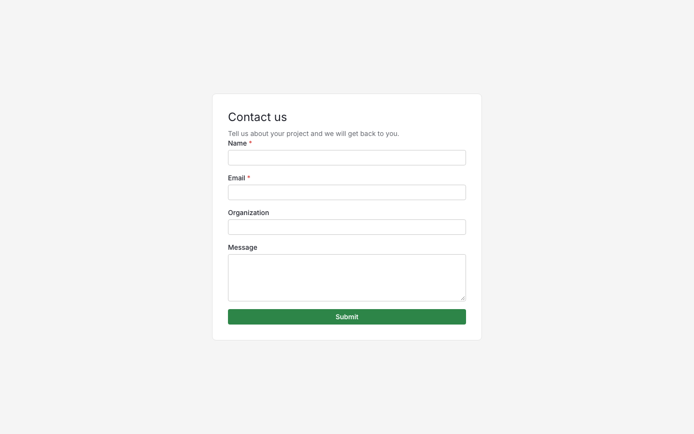
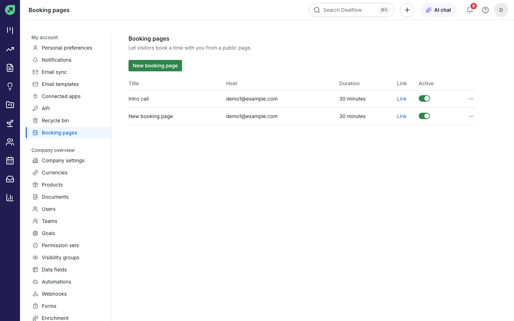
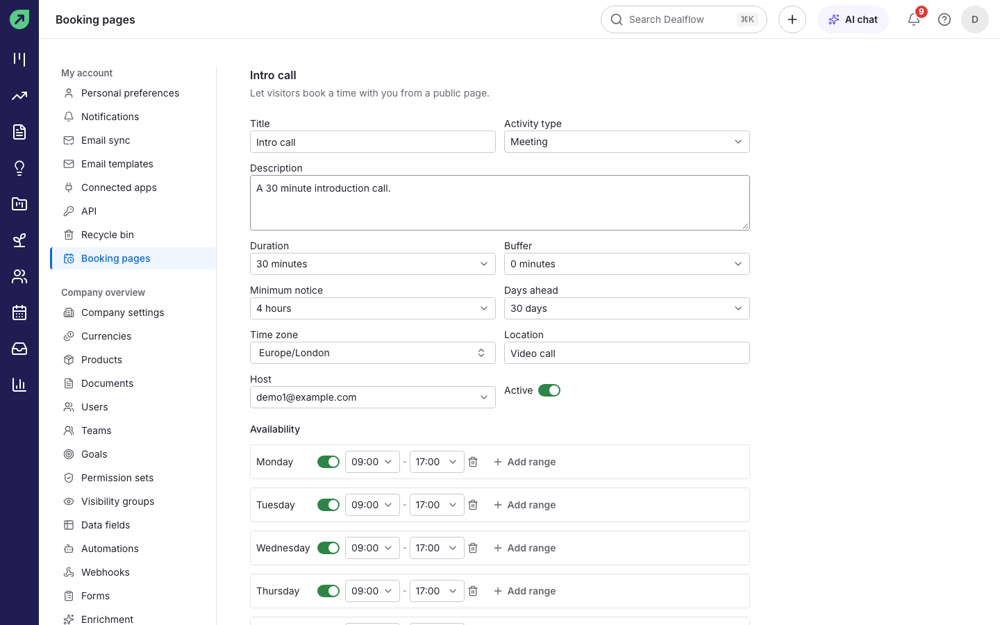
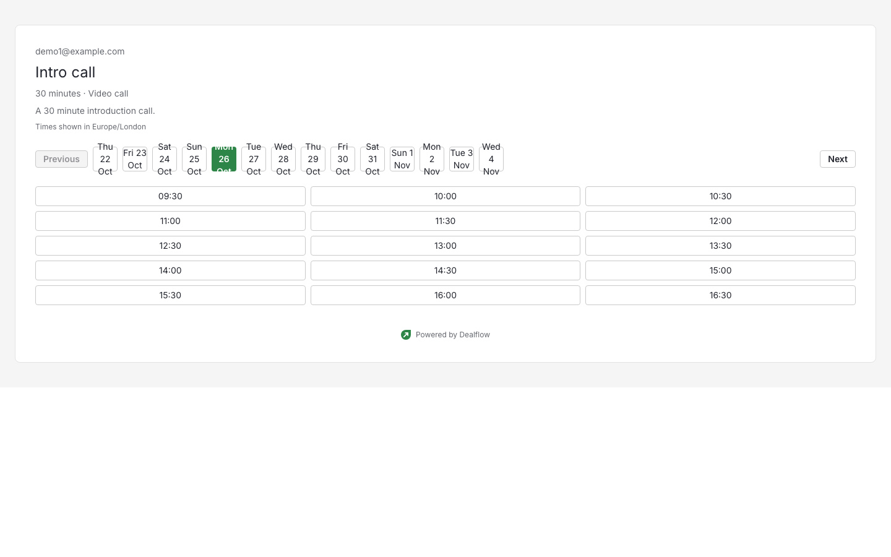

# Forms and booking pages

Web forms and booking pages are public pages that people outside your company can use without signing in.

## Web forms

A web form collects enquiries from your website and creates a lead or a deal for each submission. You need permission to manage forms.

### How to create a form

1. Go to **Settings › Forms** and select **New form**.
2. On the **Definition** tab, set the **Name**, the **Title** and **Description** visitors see, what the form **Creates** (**Lead** or **Deal**), and the **Owner** of what it creates.
3. Under **Fields**, use **Add field** to add fields such as name, email, organization, phone and message. Set each field's label and placeholder, and whether it is **Required**.
4. Set the **Success message** visitors see after submitting, or a **Redirect URL** to send them to your own thank-you page.
5. Save, and make sure the form is **Active**.

**Result:** the form gets a public link, and the **Live preview** shows what visitors will see.

### How to put a form on your website

Copy the form's public link from the forms list and link to it from your website, or embed it using the code the form editor gives you. The form also works when the visitor's browser has JavaScript turned off.

### What happens when someone submits

1. A lead (or deal) is created with the submitted details, and its source is set to the form.
2. The form's owner gets a "New form submission" notification.
3. The submission is listed on the form's **Submissions** tab.

**Tip:** forms include spam protection, so you do not need to add a captcha.

## Booking pages

A booking page lets someone pick a time to meet you. The booking goes straight into your activities.

### How to create a booking page

1. Go to **Settings › Booking pages** and select **New booking page**.
2. Set the **Title**, **Description**, **Activity type** (for example Meeting), **Duration** and **Location** (for example Video call).
3. Set the **Buffer** between meetings, the **Minimum notice** before a booking, how many **Days ahead** people can book, and your **Time zone**.
4. Under **Availability**, turn on each weekday you are available and set the hours. **Add range** adds a second block on the same day.
5. Turn on **Active** and save.

**Result:** the page appears in the list with its public **Link**.

### What your visitor sees

1. The visitor opens the link and picks a day. Times are shown in your booking page's time zone.
2. They pick a time, enter their details and confirm.

**Result:** they get a confirmation email with a link to cancel, and an activity is added to your calendar. If they cancel, the activity is removed and you are told.

**Tip:** times already taken by your other activities are not offered.
