# Getting started

This section covers signing in for the first time, finding your way around Dealflow, and the shortcuts that save time every day.

## How to sign in for the first time

Your admin invites you by email.

1. Open the invite email from Dealflow and select the link in it.
2. Type a new password in **New password** and again in **Confirm password**.
3. Select **Set password and sign in**.

**Result:** you land on your pipeline board, signed in.

**Tip:** the invite link works once. If it has expired, ask your admin to invite you again from **Settings › Users**.

## How to sign in with your password

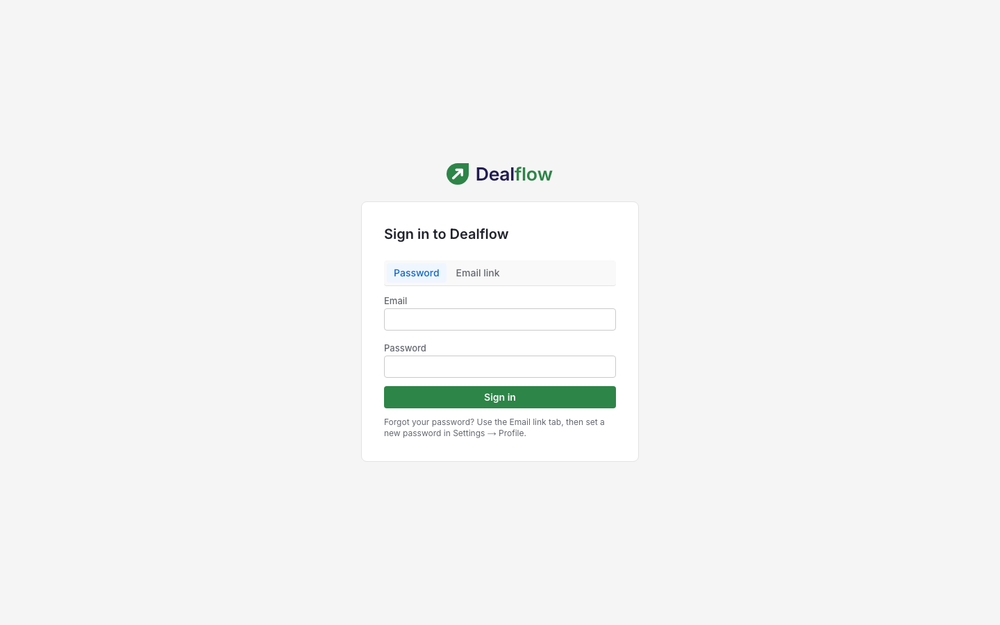

1. Go to your Dealflow address (your admin will give it to you).
2. On the **Password** tab, type your **Email** and **Password**.
3. Select **Sign in**.

## How to sign in with an email link

Use this if you would rather not type a password, or if you have forgotten it.

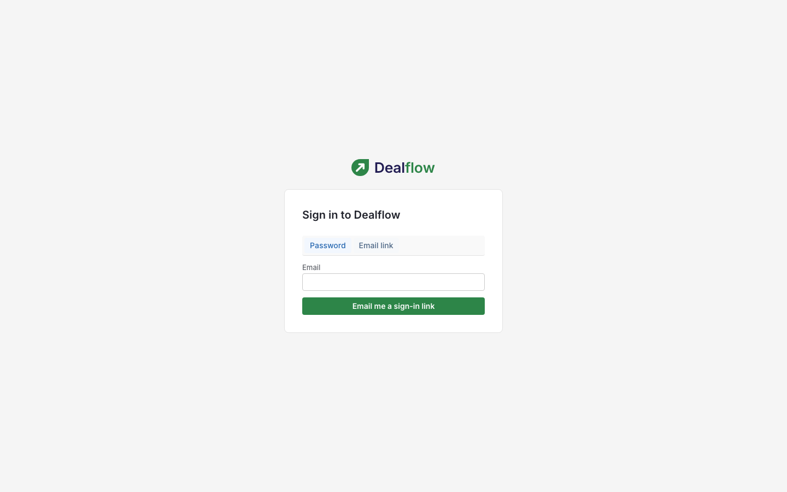

1. On the sign-in page, select the **Email link** tab.
2. Type your **Email** and select **Email me a sign-in link**.
3. Open the email from Dealflow and select the link.

**Result:** you are signed in. The page always says "If an account exists for that address, a sign-in link is on its way", whether or not the address has an account.

**Tips:**

- The link expires after 15 minutes and works once.
- Forgotten your password? Sign in with an email link, then set a new password in **Settings › Personal preferences**.

## Finding your way around

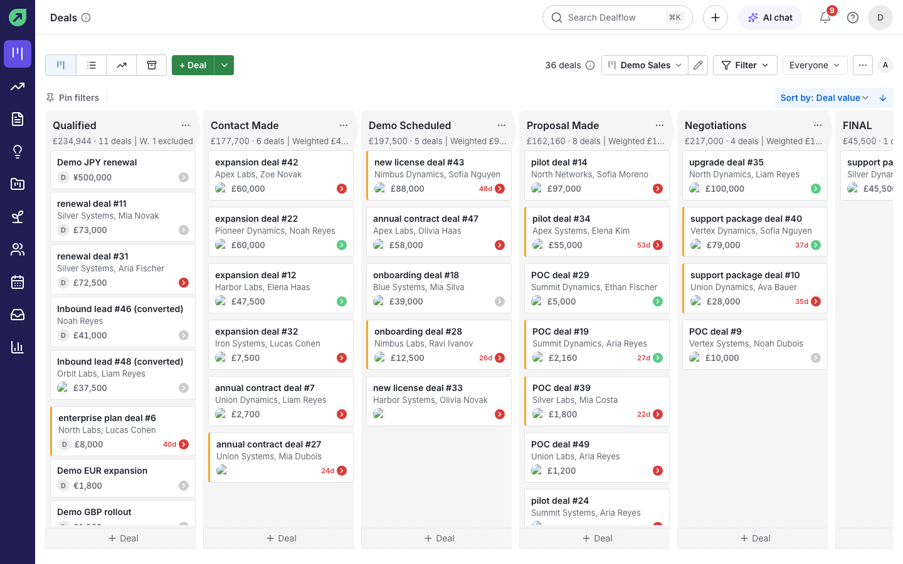

- **Left rail.** The dark bar on the left takes you to Pipeline, Forecast, Documents, Insights, Projects, Leads, Contacts, Activities, Inbox and Performance. It opens with labels at 232 px wide. The leaf logo at the top takes you home.
- **Top bar.** From left to right: the page title (with an **(i)** button that explains the page), **Search**, **Quick add** (`+`), **AI chat**, **Notifications** (the bell), **Docs** (this guide) and your **Account menu**.
- **Settings.** Open the **Account menu** and choose **Settings**.

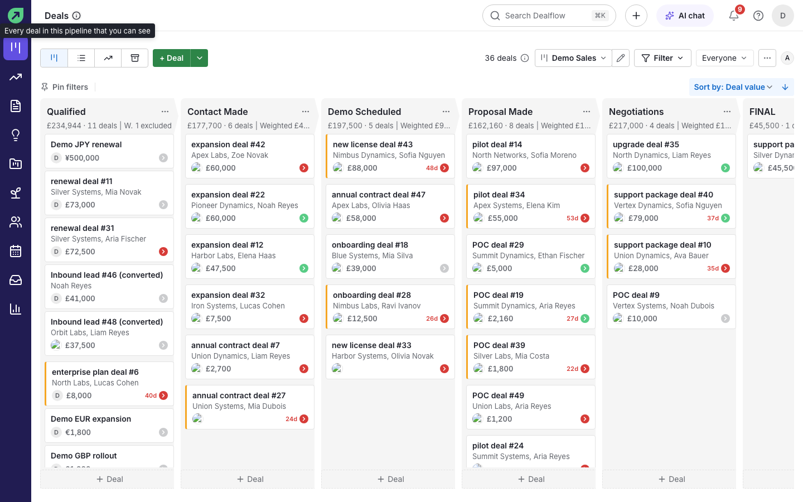

## How to expand or collapse the left rail

The rail opens at 232 px wide with every destination named. You can shrink it to icons when you want more room for the page.

1. Select **Collapse** at the bottom of the rail, or press `[`.
2. The rail becomes 56 px wide and shows icons only. Rest the pointer on an icon to see its name.

**Result:** Dealflow remembers the choice, so the rail opens the same way next time.

To bring the labels back, select the arrow at the bottom of the rail (its tooltip says **Expand sidebar**), or press `[` again. On a phone the rail becomes the bottom bar, so there is nothing to collapse.

## How to search for anything

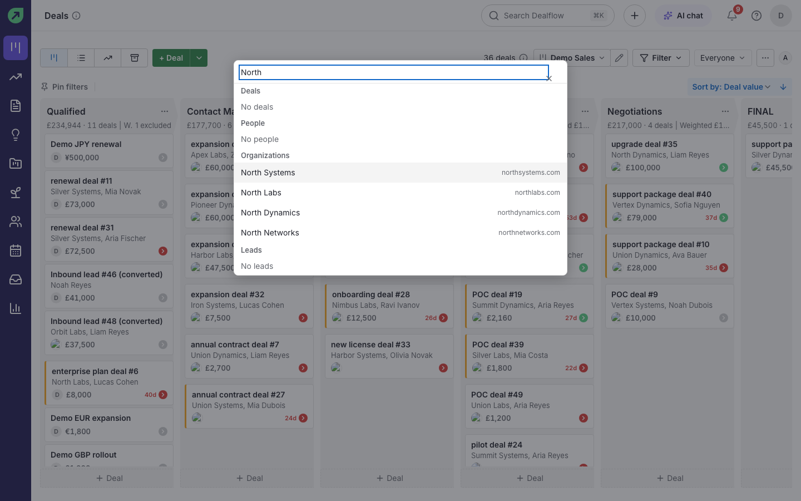

1. Select **Search Dealflow** in the top bar.
2. Start typing a name, company or deal title.
3. Select a result to open it.

**Result:** results are grouped into Deals, People, Organizations and Leads as you type.

## How to add a record quickly

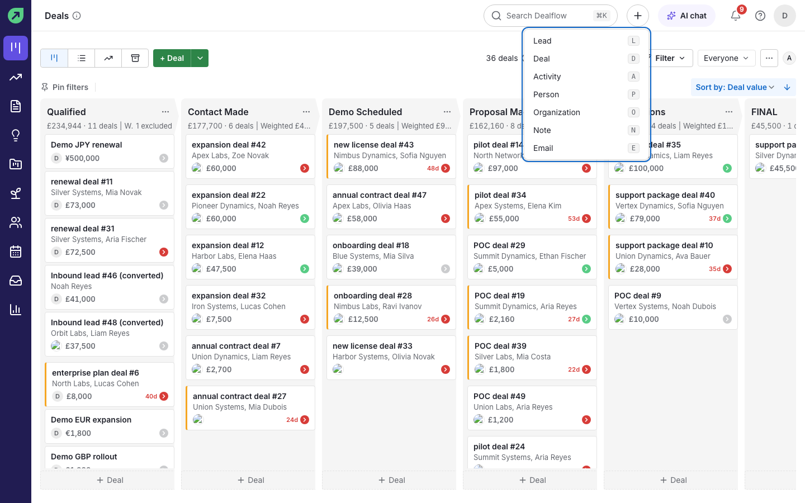

1. Select **+** (Quick add) in the top bar.
2. Choose **Lead**, **Deal**, **Activity**, **Person**, **Organization**, **Note** or **Email**.

**Tip:** with the menu open, press the letter shown next to each item (for example `D` for a deal).

## How to use the command palette

The command palette lets you go anywhere or do common actions without the mouse.

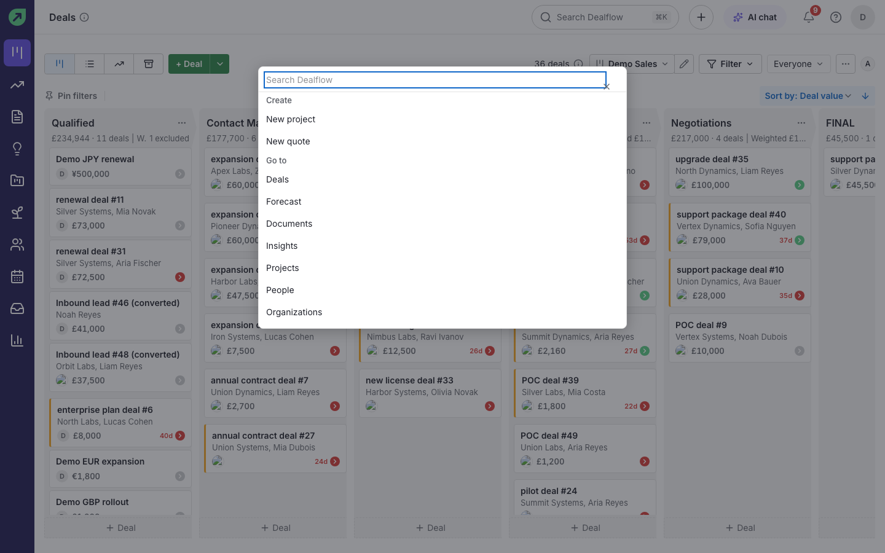

1. Press `Cmd+K` on a Mac or `Ctrl+K` on Windows.
2. Type what you want, for example "forecast" or "new quote".
3. Press `Enter`.

**Result:** the palette lists **Create** actions (new project, new quote), **Go to** destinations (every main page and settings page) and **Actions** for the page you are on, such as **Mark won**, **Mark lost**, **Log call** and **Create quote** when you are on a deal.

## Keyboard shortcuts

Press `?` anywhere outside a text box to open the shortcut sheet. The most useful ones:

| Keys | What it does |
|---|---|
| `g` then `d` | Go to Deals (`p` People, `o` Organizations, `a` Activities, `l` Leads, `i` Insights, `j` Projects, `f` Forecast, `m` Inbox) |
| `n` then `d` | New deal (`p` person, `o` organization, `a` activity, `c` log a call) |
| `j` / `k` | Move up and down a list; `Enter` opens the row |
| `1` to `9` | Jump to a navigation item |
| `Cmd+K` / `Ctrl+K` | Open the command palette |
| `[` | Collapse or expand the left rail |
| `Escape` | Close a dialog or the palette |

## How to undo a change

After many changes, such as moving a deal, Dealflow shows a message at the bottom of the screen with an **Undo** button. Select it within a few seconds to put things back.

## How to update your profile and password

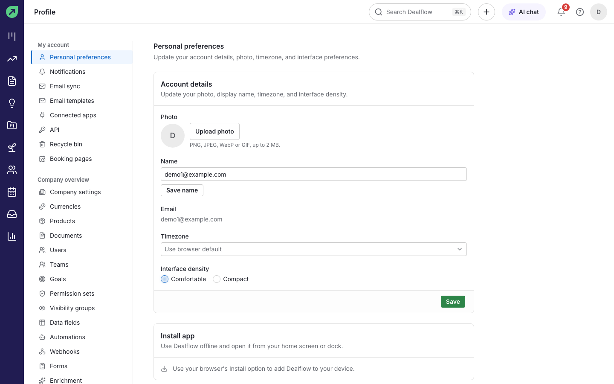

1. Open the **Account menu** and choose **Settings**. **Personal preferences** opens first.
2. Change your photo (**Upload photo**), **Name**, **Timezone** or **Interface density**, and select **Save**.
3. Further down, under **Password**, set a new password. Changing it signs you out on your other devices.

## How to switch between light and dark mode

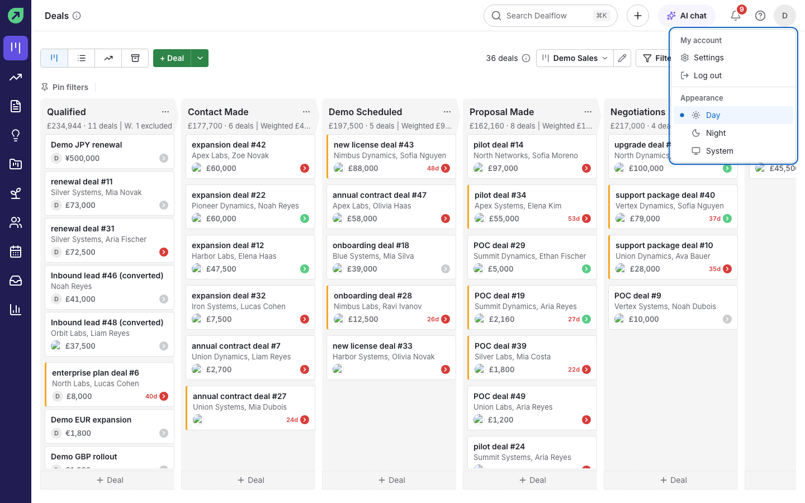

1. Open the **Account menu** (your initial, top right).
2. Under **Appearance**, choose **Day**, **Night** or **System**.

## Using Dealflow on your phone

Dealflow works in your phone's browser.

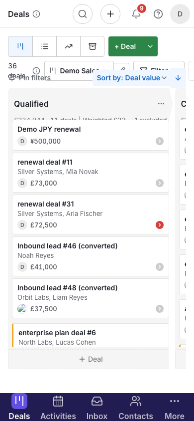

- On a phone the left rail becomes a bar along the bottom: **Deals**, **Activities**, **Inbox**, **Contacts** and **More**.
- **More** opens the rest of the app: Forecast, Documents, Insights, Projects, Leads, Performance and Settings.

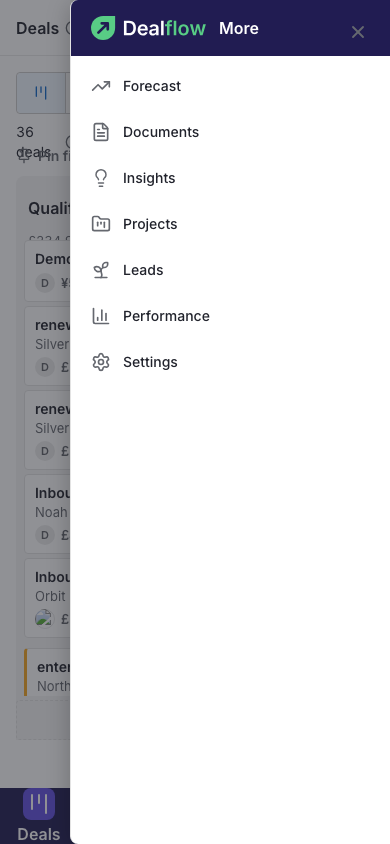

<!-- hidden while NEXT_PUBLIC_PWA_UI is off -->
**How to install it:** open Dealflow in your phone or desktop browser and use the browser's own **Install** or **Add to Home Screen** option. **Settings › Personal preferences** has an **Install app** section with the same reminder.
<!-- end hidden -->

<!-- hidden while NEXT_PUBLIC_PWA_UI is off -->
**If you lose your connection:** Dealflow shows a "You're offline" page listing the records you opened recently. They are read-only until you are back online. See [Troubleshooting](troubleshooting-faq.md).

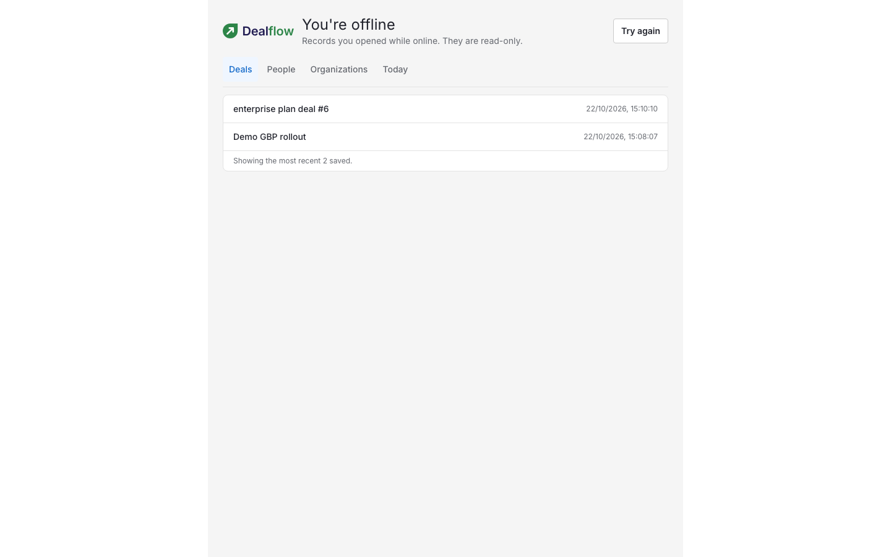
<!-- end hidden -->
