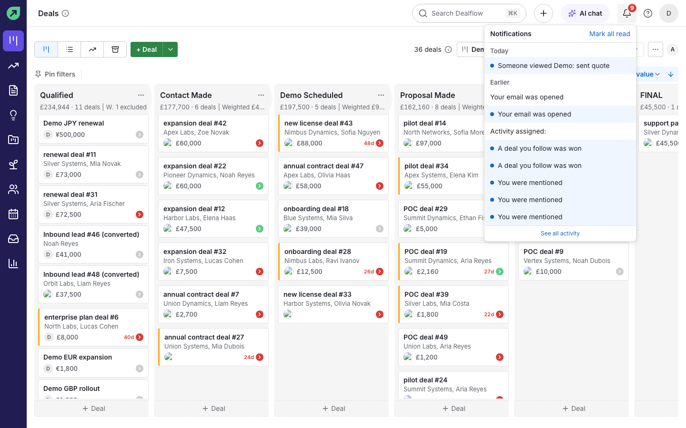
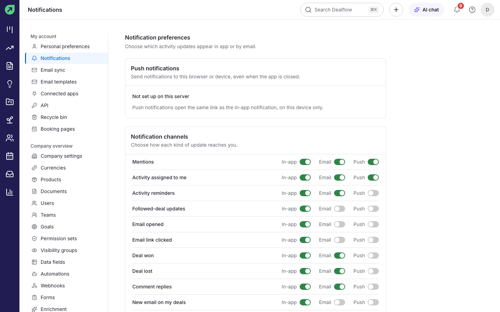

# Notifications

Dealflow tells you when something needs your attention: you were mentioned, an activity was assigned to you, a deal you follow was won, a customer viewed or accepted a quote, an email you sent was opened, and more.

## How to read your notifications

1. Select the bell in the top bar. A red badge shows how many are unread.
2. Read the list, grouped into **Today** and **Earlier**. Unread items have a blue dot.
3. Select a notification to go to the record it is about.
4. Select **Mark all read** to clear the badge, or **See all activity** for the full list.

## How to choose what you are notified about

1. Go to **Settings › Notifications**.
2. For each kind of update (**Mentions**, **Activity assigned to me**, **Activity reminders**, **Followed-deal updates**, **Email opened**, **Email link clicked**, **Deal won**, **Deal lost**, **Comment replies**, **New email on my deals** and others), turn **In-app** and **Email** on or off.

**Result:** changes take effect straight away.

## How to mention a teammate

1. In a note on a deal, person or organization, type `@` followed by the teammate's name.
2. Pick them from the list and save the note.

**Result:** they get a "You were mentioned" notification that links to the note.

## How to follow a record

Open a deal or contact and use the follower control in the header (it shows the number of followers). Followers get updates about the record without owning it.
