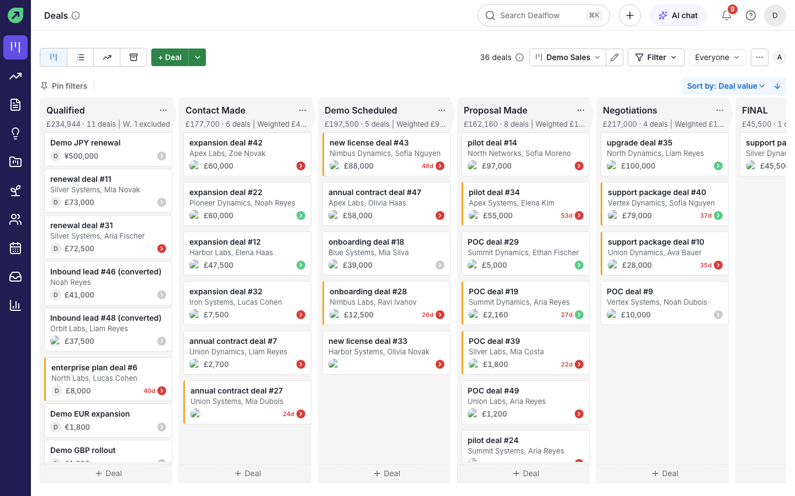
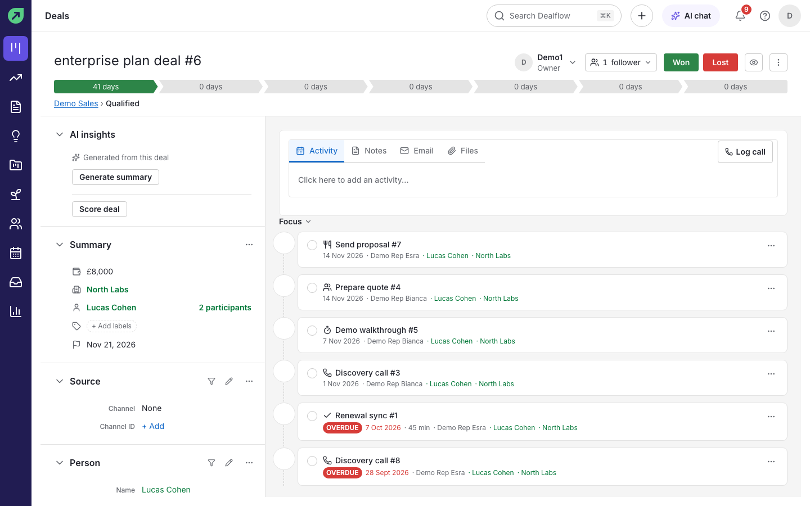
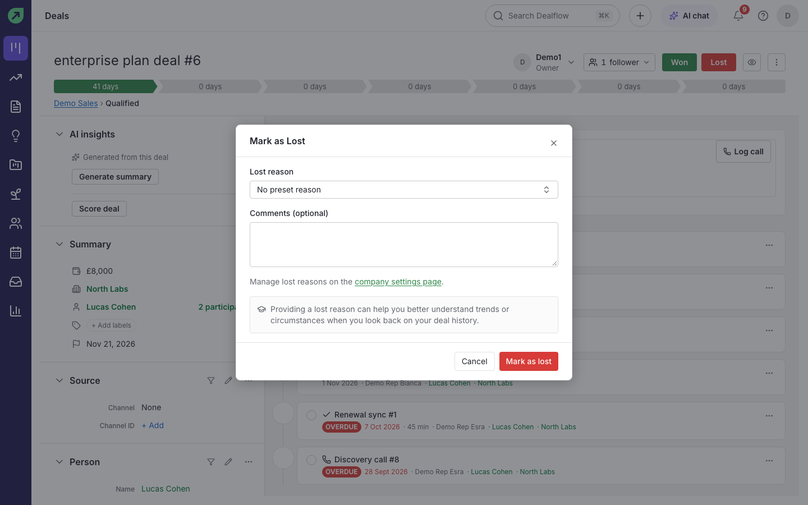
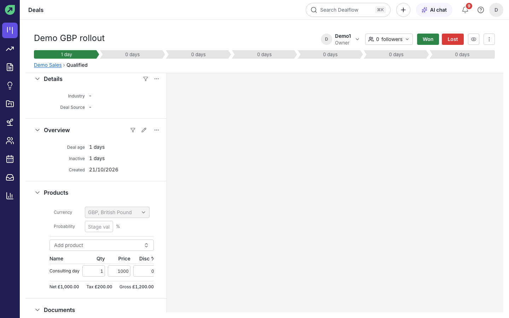
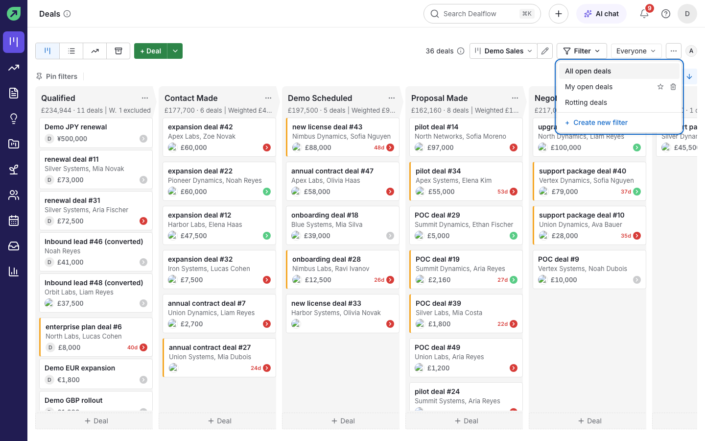
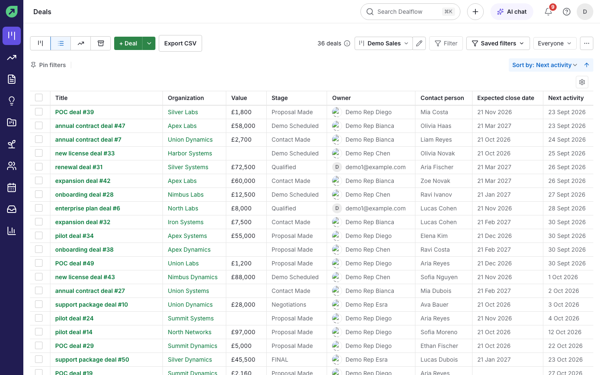
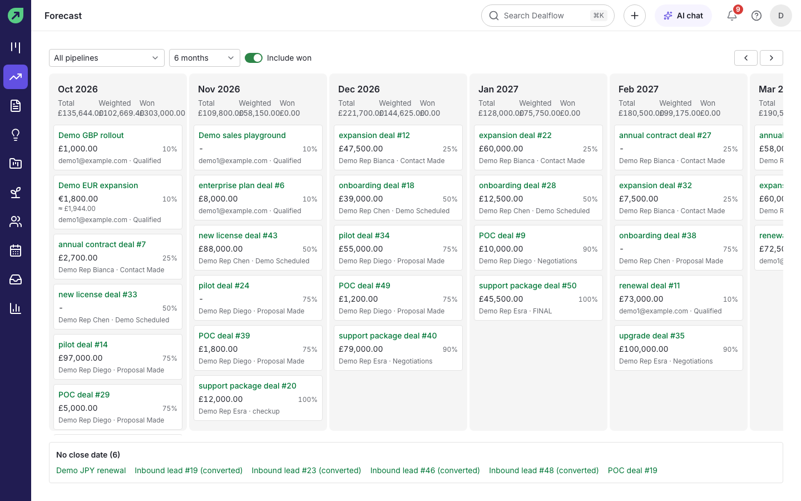
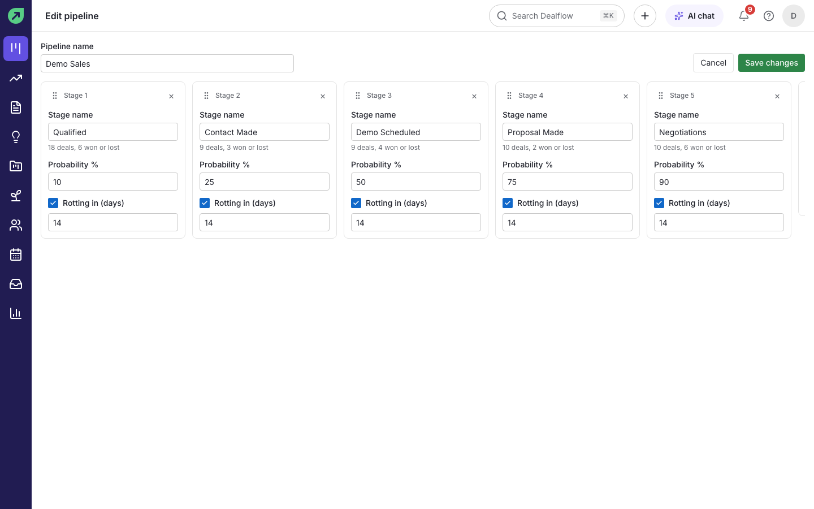
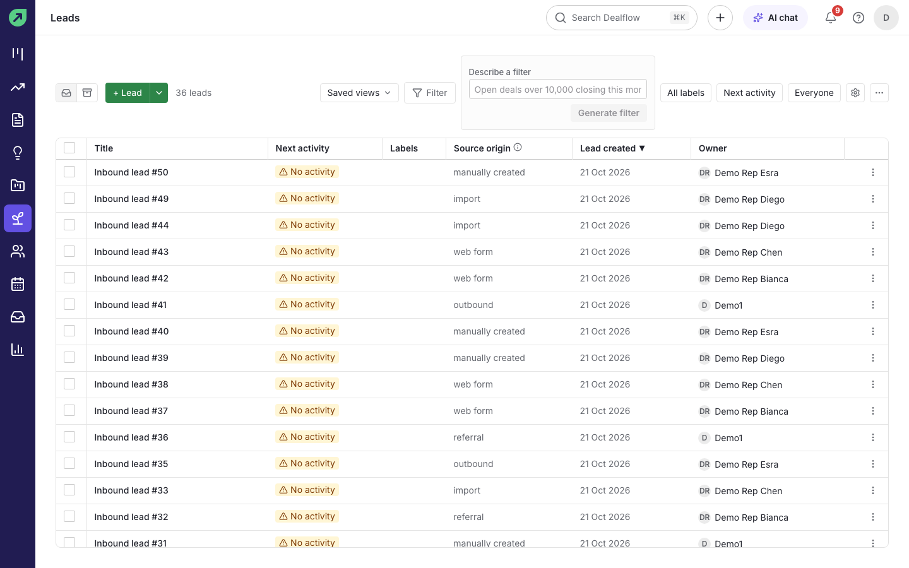
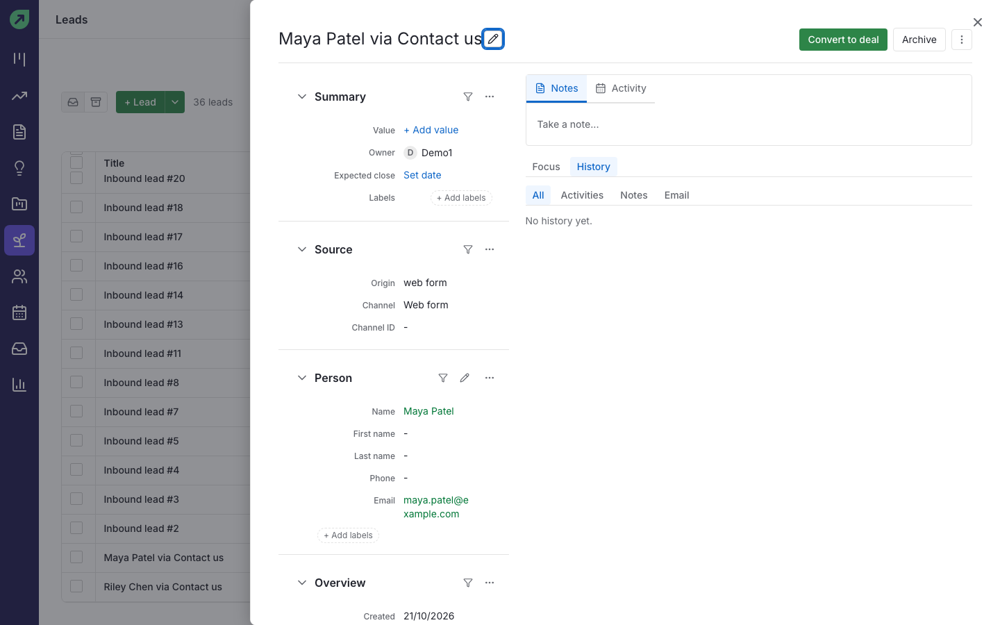

# Pipelines and deals

A **pipeline** is the path your deals follow, split into **stages**. The **board** shows one column per stage, with the total value, number of deals and weighted value at the top of each column.

## How to read the board

- Each card shows the deal title, the organization and person, the value, and a coloured dot for the next activity: green when something is scheduled, grey when nothing is, red when it is overdue.
- A number like **40d** on a card means the deal is **rotting**: it has been in the stage longer than the stage allows.
- The toolbar switches between **Board view**, **List view**, the forecast and **Archived deals**, and holds **+ Deal**, the pipeline picker, **Filter**, the owner picker (**Everyone** or one person) and **Sort by**.

## How to add a deal

1. On the board, select **+ Deal** (or press `n` then `d`).
2. Fill in **Title**, **Value** and currency, **Pipeline** and **Pipeline stage**. Add a **Contact person** or **Organization** if you have them.
3. Optionally set **Labels**, **Expected close date**, **Owner** and any company-specific fields.
4. Select **Save**.

**Result:** the new card appears at the bottom of its stage column.

**Tip:** fields marked with an asterisk are required by your company. Admins choose these in **Settings › Data fields**.

## How to move a deal to another stage

1. On the board, drag the card to another column.
2. Let go.

**Result:** the card moves, the column totals update, and a message says "Moved to {stage}" with an **Undo** button.

## How to open a deal

Select a card on the board, or a title in the list view.

The deal workspace has:

- **The header:** title, owner, followers, **Won** and **Lost** buttons, and the stage track showing how long the deal has spent in each stage.
- **The left column:** **AI insights**, **Summary** (value, organization, person, participants, labels, expected close date), **Source**, **Person**, **Products**, **Documents**, **Projects** and any custom fields.
- **The right column:** tabs to add an **Activity**, **Notes**, **Email** or **Files**, the **Focus** list of what needs attention, and **History** (with All, Activities, Notes, Email, Files and Changelog).

## How to mark a deal as won or lost

1. Open the deal.
2. Select **Won**, or select **Lost**.
3. For a lost deal, choose a **Lost reason**, add optional **Comments**, and select **Mark as lost**.

**Result:** the deal leaves the board and shows **Won** or **Lost** in its header.

**Tips:**

- To bring a deal back, open it and select **Reopen**.
- Admins edit the list of lost reasons in **Settings › Company settings › Lost reasons**.
- When you are on a deal, the command palette also offers **Mark won** and **Mark lost**.

## How to add products to a deal

Products come from your company's catalogue (see [Quotes and invoices](quotes-and-invoices.md)).

1. Open the deal and find the **Products** section.
2. Select **Add product** and choose a product.
3. Change **Qty**, **Price** or **Disc %** if needed.

**Result:** the deal value becomes "Calculated from products", and the section shows the net, tax and gross totals.

**Tip:** a deal has one currency. Values in other currencies are converted to your company's base currency in totals, using the rates in **Settings › Currencies**.

## How to filter and sort the board

1. Select **Filter**.
2. Choose a saved filter such as **All open deals**, **My open deals** or **Rotting deals**, or select **Create new filter** to build your own.
3. Use the owner picker to see **Everyone** or one person, and **Sort by** to order the cards (for example by next activity or deal value).

**Tip:** **Pin filters** keeps your favourite filters visible above the board.

## How to use the list view

1. Select **List view** in the toolbar.
2. Sort by any column header. Select a title to open the deal.
3. Select **Export CSV** to download the list (if your permissions allow exports).

## How to see archived deals

Select the archive icon in the toolbar. Archiving takes a deal off the board without deleting it; you can restore it from this list.

## How to see the forecast

1. Select **Forecast** in the left rail.
2. Choose the pipeline, how many months to show, and whether to **Include won** deals.

**Result:** one column per month, showing each open deal by expected close date with its value and probability, plus the month's **Total**, **Weighted** and **Won** amounts. Deals without an expected close date are listed underneath.

## How to edit a pipeline's stages

You need permission to manage pipelines.

1. On the board, select the pencil icon next to the pipeline name (or go to **Settings › Company settings › Pipelines**).
2. Rename stages, change each stage's **Probability %**, and turn on **Rotting in (days)** to flag deals that sit too long.
3. Select **Save changes**.

## Leads

Leads are enquiries you have not qualified yet, for example from a web form.

### How to work through your leads

1. Select **Leads** in the left rail.
2. Use **Saved views**, **Filter**, the label and owner pickers, or **Describe a filter** (see [AI features](ai-features.md)) to narrow the list.
3. Select a lead to open it.

### How to convert a lead into a deal

1. Open the lead.
2. Select **Convert to deal**.

**Result:** a deal is created with the lead's details and the lead is marked as converted.

**Tip:** select **Archive** instead to clear a lead you will not pursue.
