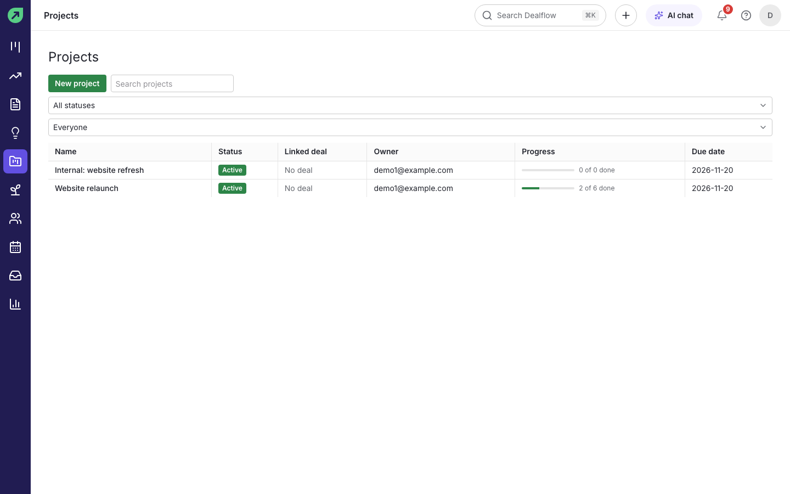
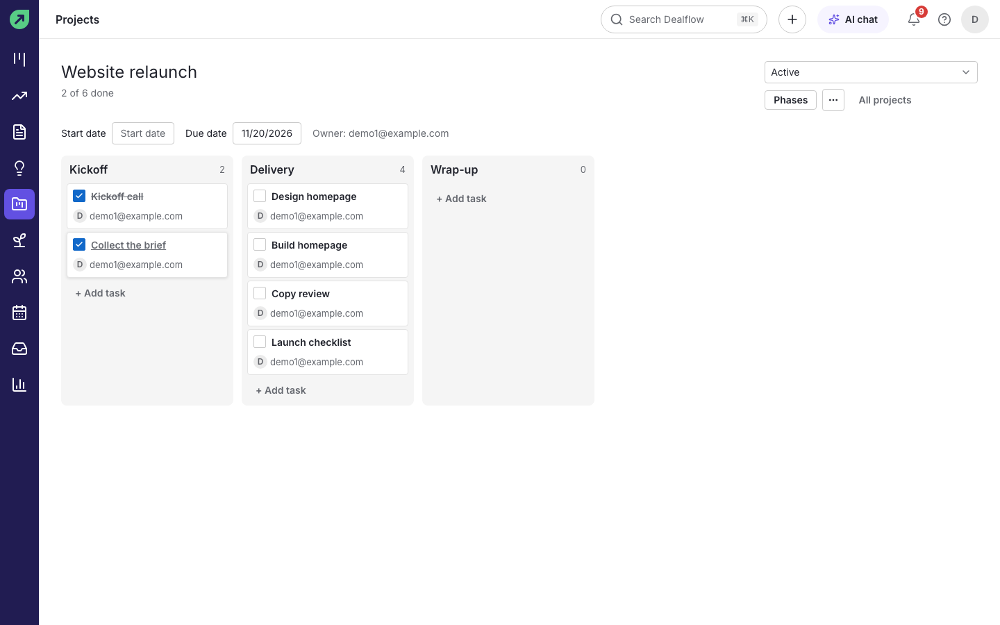

# Projects

Projects track the work that follows a won deal, such as onboarding or delivery. A project has phases (for example Kickoff, Delivery and Wrap-up), and each phase holds tasks.

## How to see your projects

1. Select **Projects** in the left rail.
2. Filter by status and owner, or search by name.

**Result:** each project shows its status, linked deal, owner, progress (tasks done out of the total) and due date.

## How to create a project

1. In **Projects**, select **New project**.
2. Enter a **Name**, and optionally choose a **Linked deal**, the **Owner**, a **Start date** and a **Due date**.
3. Name the **Phases** the project moves through. Use **Add phase** for more, or **Remove** to drop one.
4. Select **Create project**.

**Result:** the project opens with one column per phase.

## How to start a project from a won deal

1. Open the won deal.
2. In the **Projects** section of the left column, select **Create project**.

**Result:** a project named after the deal is created and linked to the deal, its person and organization, with the deal owner as project owner.

## How to add and complete tasks

1. Open the project.
2. Under a phase, select **+ Add task**, type the task and press `Enter`.
3. Tick a task's box when it is done.

**Result:** the progress bar and the "x of y done" count update.

**Tips:**

- Set the project's status (for example **Active**) at the top right.
- Linked projects also appear in the deal's **Projects** section.
- An admin can create an automation that starts a project when a deal is won (see [Admin](admin.md#how-to-automate-routine-work)).
