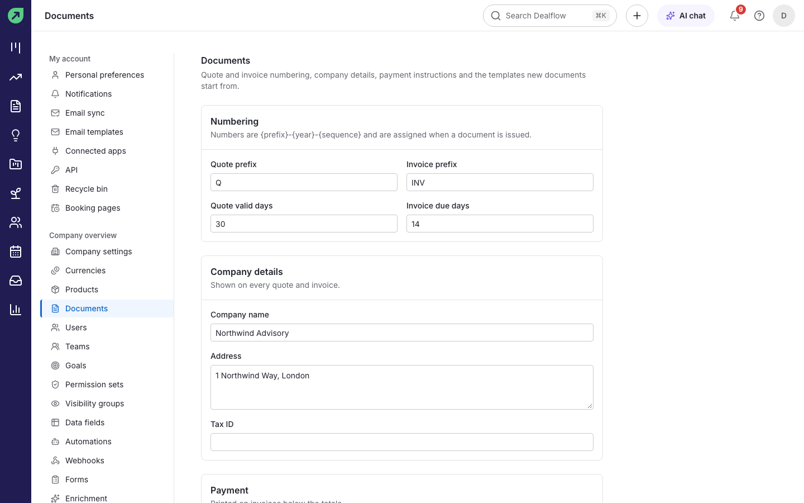
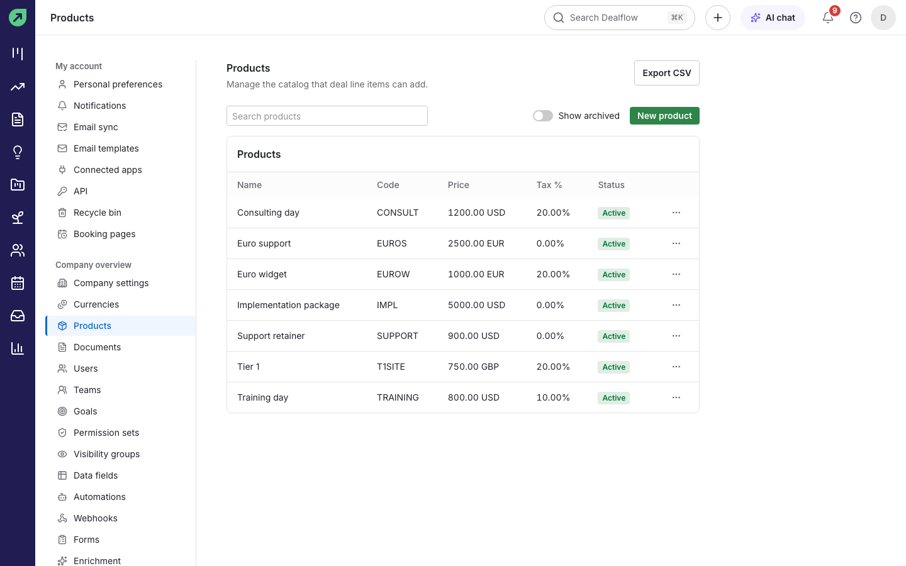
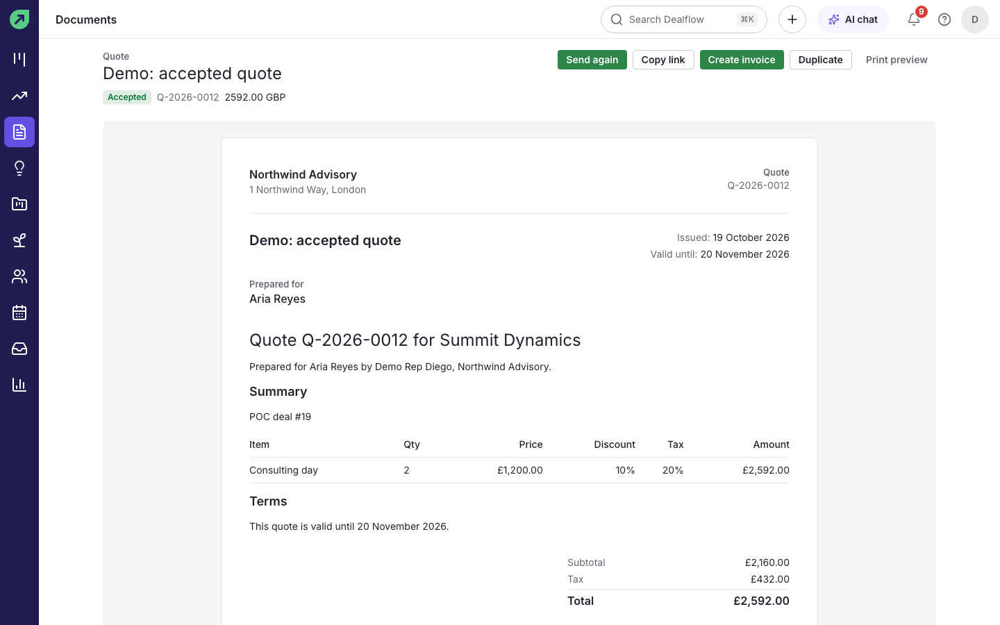
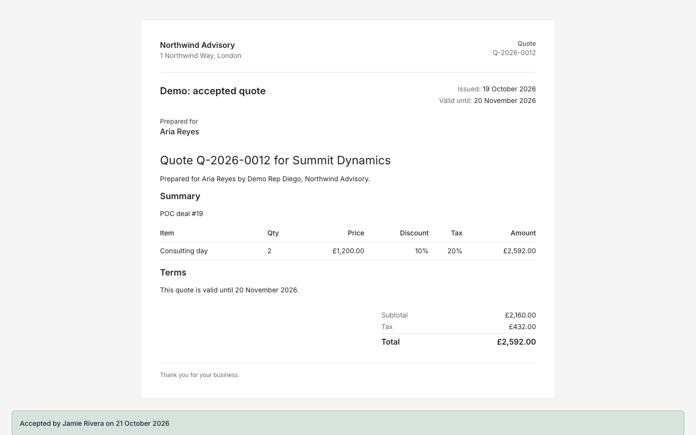
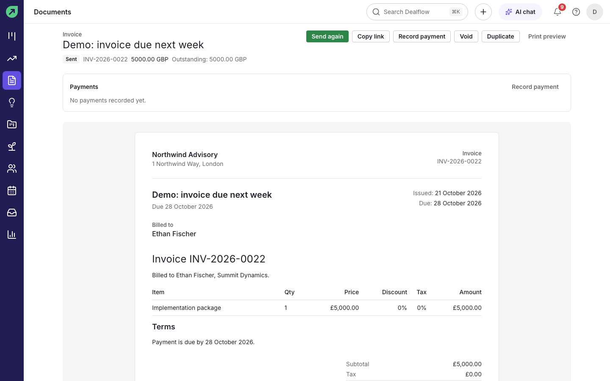
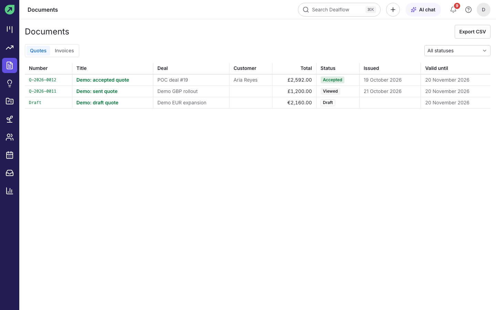
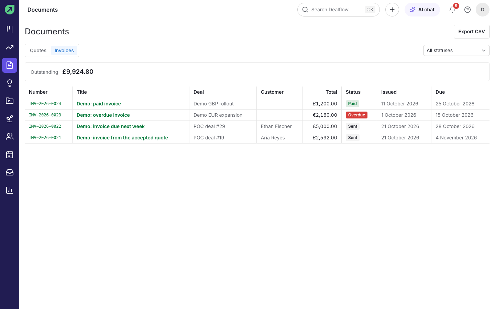

# Quotes and invoices

Dealflow builds quotes and invoices from a deal's products, sends them to your customer by email with a link to a public page, and tracks them from draft to paid. You need the documents permission to create and send them.

## How to set up your company details and numbering

An admin does this once.

1. Go to **Settings › Documents**.
2. Under **Numbering**, set the **Quote prefix** and **Invoice prefix**, how many days a quote stays valid (**Quote valid days**) and how many days an invoice gives to pay (**Invoice due days**). Numbers look like `Q-2026-0012` and are assigned when a document is issued.
3. Under **Company details**, enter the **Company name**, **Address** and **Tax ID** printed on every document.
4. Under **Payment**, enter the **Payment instructions** printed on invoices.
5. Save.

## How to manage products

You need permission to manage products.

1. Go to **Settings › Products** and select **New product**.
2. Enter the **Name**, **Code**, **Price** and currency, and **Tax %**.
3. Select **Save**.

**Tip:** a product you no longer sell can be archived; turn on **Show archived** to see it again.

## How to create a quote

1. Open the deal and add its products (see [Pipelines and deals](pipelines-and-deals.md#how-to-add-products-to-a-deal)).
2. In the deal's **Documents** section, select **New quote** (or use **Create quote** in the command palette).
3. Check the **Title**, **Valid until** date, **Customer**, **Customer email** and **Customer address**, and edit the body if you need to. **Refresh from deal** pulls in the latest products.
4. Select **Save draft**.

**Result:** a draft quote is saved. **Print preview** shows exactly what the customer will see.

## How to send a quote

1. Open the draft quote.
2. Select **Send**.

**Result:** the quote is issued (it gets its number), and your customer receives an email with a link to it. The status changes to **Sent**, then **Viewed** when they open it.

**Tips:**

- **Issue** gives the quote a number without emailing it, and **Mark as sent** records a quote you sent some other way. **Copy link** copies the customer link so you can share it yourself.
- **Send again** resends a quote that has already gone out.
- You get a notification when the customer views, accepts or declines.
- After its **Valid until** date a quote can no longer be accepted. Duplicate it to send a fresh one.
- A draft you no longer need can be removed with **Delete draft**. Issued documents are never deleted.

## What your customer sees

Your customer opens the link without signing in. They can read the quote, select **Download PDF**, and either type their full name and select **Accept quote**, or select **Decline**. An accepted quote shows who accepted it and when.

## How to create an invoice

1. Open an accepted quote and select **Create invoice**, or in the deal's **Documents** section select **New invoice**.
2. Check the details and select **Send** (or **Save draft** to finish later).

**Result:** the invoice is numbered, emailed to the customer, and shown with its due date.

## How to record a payment

1. Open the invoice.
2. Select **Record payment**, enter the amount and date, and save.

**Result:** the payment is listed under **Payments** and the outstanding amount goes down. When it reaches zero the invoice is marked **Paid**.

**Tips:**

- Invoices past their due date are marked **Overdue** automatically.
- **Void** cancels an invoice you sent by mistake. Its number is not reused.
- **Duplicate** makes a copy of any quote or invoice.

## How to see all your documents

1. Select **Documents** in the left rail.
2. Switch between **Quotes** and **Invoices**, and filter by status.

**Result:** the list shows each document's number, title, deal, customer, total, status and dates. The invoices tab also shows the total outstanding. **Export CSV** downloads the list.
