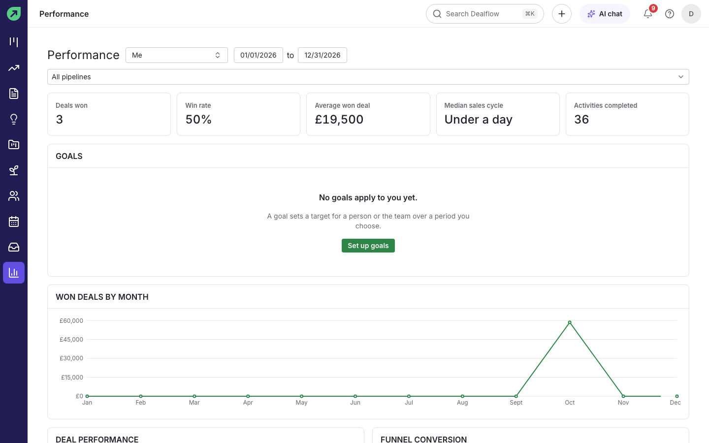
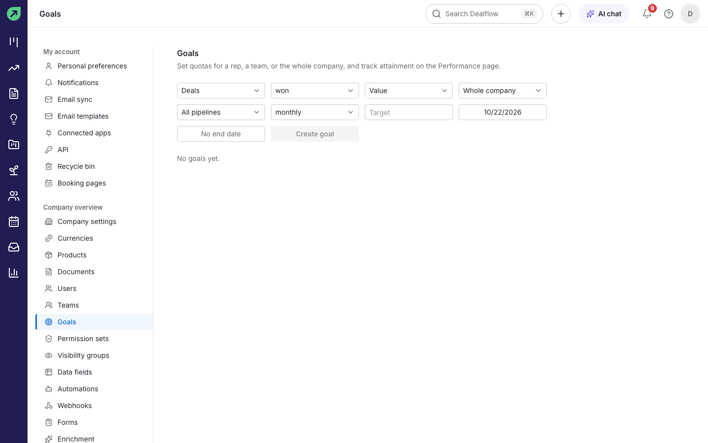
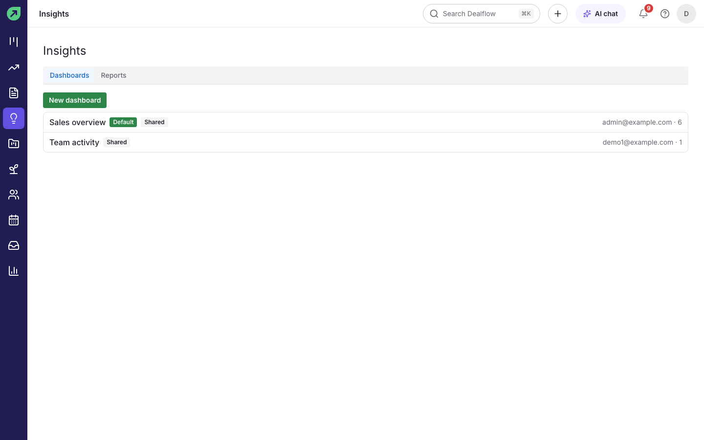
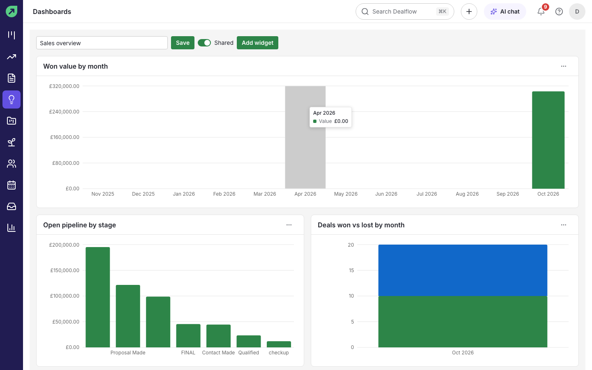
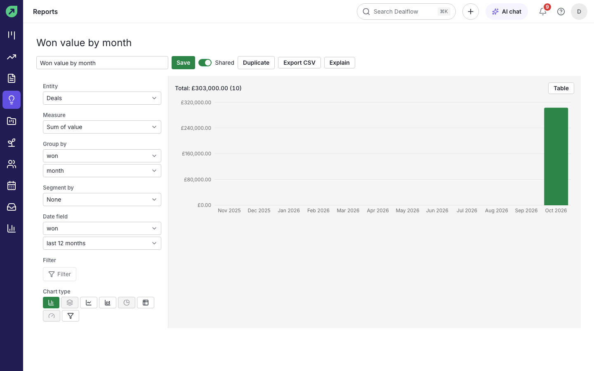

# Stats and reporting

Dealflow has two places for numbers:

- **Performance** gives you and your team a quick view of results against goals.
- **Insights** is where you build dashboards and reports of your own.

## How to check your performance

1. Select **Performance** in the left rail.
2. Choose whose numbers to see (**Me**, a teammate or a team, if you are allowed to see others), the date range and the pipeline.

**Result:** the cards show **Deals won**, **Win rate**, **Average won deal**, **Median sales cycle** and **Activities completed**, followed by your **Goals**, deals won by month, deal performance and funnel conversion.

## How to set a goal

You need permission to manage goals.

1. Go to **Settings › Goals**.
2. Choose what the goal counts: deals (added, won or lost, by value or count) or activities.
3. Choose who it is for (**Whole company**, **A team** or **One person**), the pipeline, the period (**weekly**, **monthly**, **quarterly** or **yearly**), the target, and the start and end dates.
4. Select **Create goal**.

**Result:** progress against the goal appears on the Performance page of everyone it applies to.

## How to use dashboards

1. Select **Insights** in the left rail. **Dashboards** lists the dashboards you can see; the default dashboard is marked **Default**.
2. Select a dashboard to open it.

3. To change it, select **Add widget** to add a chart, or use a widget's menu to edit or remove it. Select **Save** when you are done.
4. Turn **Shared** on to let your colleagues see it.

**Tip:** select **New dashboard** on the Insights page to start an empty one.

## How to build a report

1. In **Insights**, open **Reports** and select a report, or create a new one.
2. Choose the **Entity** (for example Deals), the **Measure** (for example Sum of value), what to **Group by** (for example won month) and an optional **Segment by**.
3. Choose the **Date field** and range, add a **Filter** if you need one, and pick a **Chart type**.
4. Select **Save**.

**Result:** the chart and its total update as you change each setting. Select **Table** to see the numbers behind the chart.

**Tips:**

- **Export CSV** downloads the report's data.
- **Duplicate** makes a copy you can change without affecting the original.
- **Explain** asks the AI to describe what the report shows (see [AI features](ai-features.md)).

## The forecast

For expected revenue by month, use **Forecast** (see [Pipelines and deals](pipelines-and-deals.md#how-to-see-the-forecast)).
